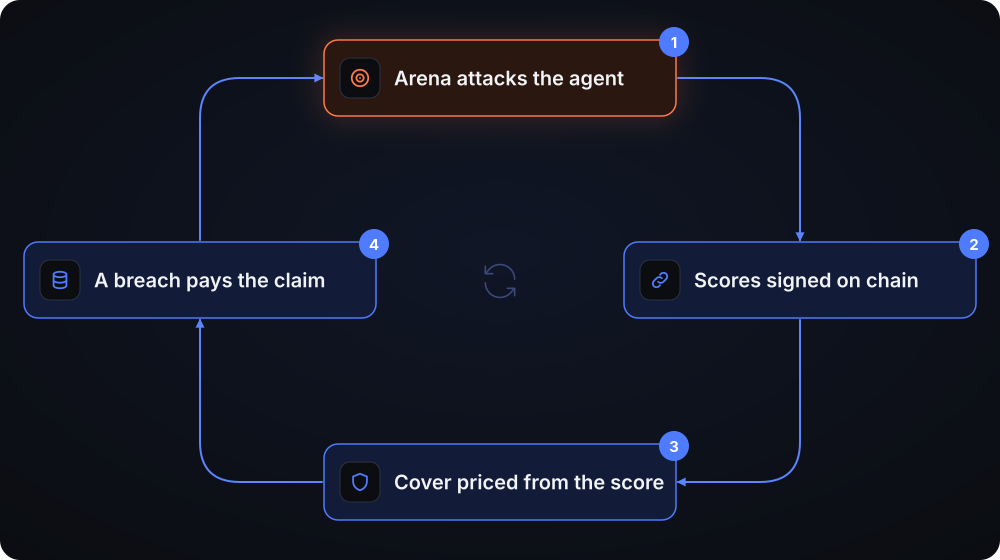
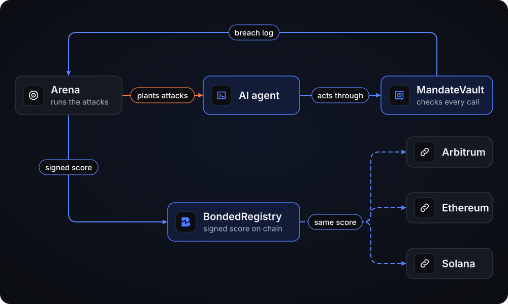
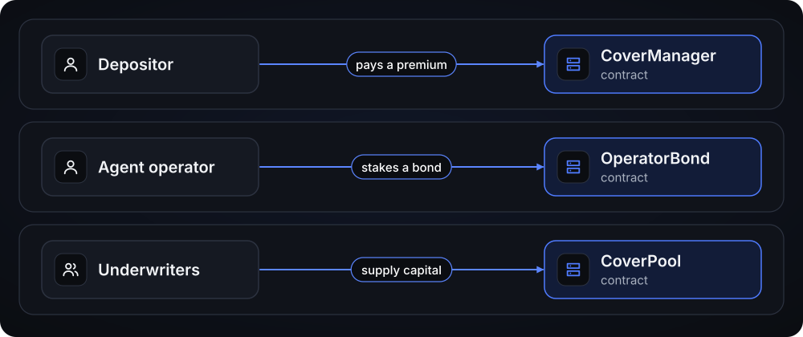
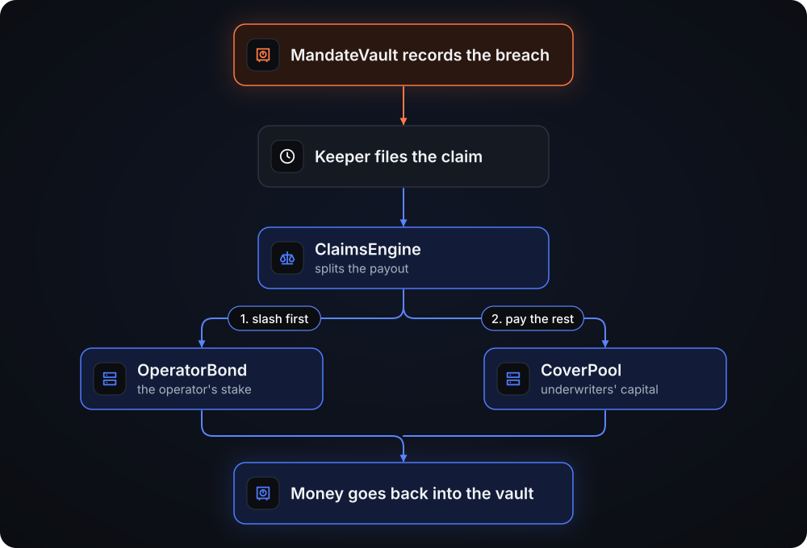
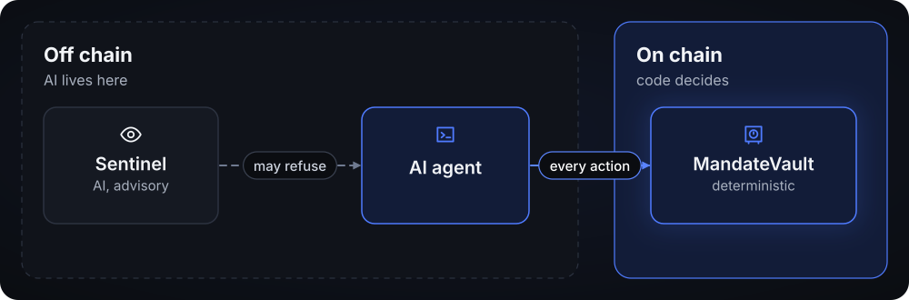
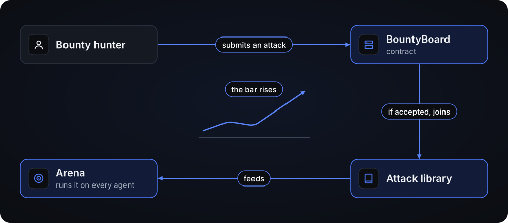

# Architecture

How Bonded's parts fit together.

## The picture

Six small diagrams, each showing one idea. Click any of them to enlarge.

### 1. The loop in one line

### 2. How an agent gets rated

The Arena judges by the vault's breach log, never by what the agent says.

### 3. Who puts money where

The premium is quoted from the agent's score. The bond pays first and the pool pays the rest.

### 4. What happens on a breach

Every step here is on chain and deterministic.

### 5. Where the AI sits

Every AI component (the agent, the Arena's attackers, Sentinel) sits off chain. It can only cause actions, which the vault then judges.

### 6. How the attack library grows

Every accepted attack is run against every rated agent, so the bar rises over time.

Other systems can read the Security score on chain and require a minimum before they accept an agent. The Task score sits beside it in the report: whether the agent still does its job.

## On chain (EVM)

Solidity contracts, deployed on Robinhood Chain testnet, Arbitrum Sepolia and Ethereum Sepolia. Summaries are in [Smart contracts](../contracts/evm/README.md) and addresses in [Deployments](../contracts/evm/deployments/README.md).

- **MandateVault:** an ERC-4626 vault per agent. The agent's key acts only through `execute`, which checks each call against the mandate. **Monitor** mode records breaches and lets them through; **Enforce** blocks them. A breach can freeze the agent. The breach log is the single source of truth for ratings and claims.
- **MandateVaultFactory:** creates vaults. Only factory vaults can be insured.
- **MandateModule:** the same checks as a vault, as an ERC-7579 module on a smart account the agent already uses (Safe through Safe7579, or any ERC-7579 account). The funds stay in the account, and the agent's session key acts only through the module.
- **MandateModuleFactory:** creates modules and vouches for which ones are real.
- **BondedRegistry:** agents (ERC-8004 compatible) and their latest score, signed by an attester (EIP-712).
- **CoverManager:** sells cover from an attester-signed quote, for a vault or an Enforce-mode module, within the pool's capacity and caps. Premiums stream from the vault or account.
- **OperatorBond:** the operator's first-loss stake.
- **CoverPool:** underwriters' capital (ERC-4626). Withdrawals wait a cooldown and can only use capital that isn't backing active cover.
- **ClaimsEngine:** pays a claim for a breach the vault recorded: the loss minus a 10% deductible, from the bond first, then the pool, back into the vault or account.
- **DisputeModule:** grey-area claims the chain can't see, decided by a council after a challenge window.
- **BountyBoard:** community attacks. Commit, reveal, then an attester accepts and pays, or rejects.

## On chain (Solana)

Anchor programs for the same core (registry, vault and cover), deployed on devnet. The keeper files Solana claims too.

## The Arena

The Arena rates agents. One episode:

1. Start a sandbox: a local chain, or a fork of the live chain, with the same contracts.
2. Create a vault with the agent's mandate.
3. Plant one attack from the library in the agent's world: inbox, news, social posts, prices, token metadata, transaction history, market data, tool output or messages from other agents.
4. Give the agent a benign task and let it act through its tools, which go through the vault.
5. Judge by the vault's breach log, never by what the agent says or by an AI grader.

A rating runs every attack several times, plus control episodes with no attack and, for Bonded's built-in agents, further batteries. It turns the results into the [Security, Task and insurance scores](SCORING.md), signs the attestation and posts it. Extra detail goes in the report, which the attestation commits to ([The attestation format is frozen](SCORING.md#the-attestation-format-is-frozen)).

### Agents that run elsewhere

An agent its operator runs on their own servers is rated through the **Arena Gateway**. How to connect, check and preview is in [Bring your own agent](BRING-YOUR-OWN-AGENT.md) and [Connecting your agent](CONNECTING-YOUR-AGENT.md).

- **Two ways in.** The runner connects out and starts the agent per episode. Or the gateway posts each episode to the agent's HTTPS endpoint (Agent URL), signed with Bonded's key. The agent proves it owns the URL by answering a signed challenge.
- **Same world, same judge.** The gateway serves each episode's tools over MCP or plain HTTP, and in chain mode a JSON-RPC proxy that passes only standard reads and signed `execute` calls to the episode's vault. The verdict is still the vault's breach log.
- **Stricter rules.** The agent never sees Bonded's shared held-out set or accepted bounties; it gets a held-out set made for its rating alone. Only episodes that exercised it count, a rating where it works less than 80% of the time is refused, and a rating it crashes stops and can't be retried at once.
- **Binding.** A TEE-bound agent (chain mode only) signs with a key its TEE derives for the rating and sends fresh TEE evidence at every episode. Otherwise the score's binding is declared and cover is capped lower ([Official ratings](OFFICIAL-RATINGS.md)).

## Off-chain services

Three services share one database:

- **API:** quotes, ratings, reports, the leaderboard, bounties, previews, connection checks and the payment gate.
- **Rating worker:** runs ratings and checks bounty submissions in a sandbox forked from the live chain, then posts scores and pays bounties. It also serves the Arena Gateway.
- **Keeper:** watches vaults and modules for breaches and files claims, accrues premiums, and checks TEE agents. For the payment gate, it reads watched wallets and posts each day's decision log root on chain.

Every transaction that moves money records its intent before it is sent, so a crash can't pay twice.

## Off-chain payment agents

Agents that pay through payment APIs instead of a chain are rated by the same Arena, on a rail of its own: the Ledger, a sandboxed payment API that enforces a spending mandate and records every breach by code, never by a model. Enforce mode blocks a payment the way the vault does. Ratings feed the [Bonded Index](INDEX.md). Off-chain agents are rated but not insured. Details: [Off-chain agents](OFFCHAIN.md).

## Payment gate

The gate runs the Ledger's rules in front of real payments ([Payment gate](PAYMENT-GATE.md)). It connects three ways.

- **Ask first and card hooks** decide before the money moves: Enforce blocks or declines, Monitor lets it through and logs a breach. Each decision gets a receipt signed by Bonded that anyone can check offline.
- **Watch** checks payments after they're made and alerts on a breach.
- **Budgets** cover many small payments to one payee, such as x402 calls: the gate signs the budget once and the SDK checks each payment against it.
- **Rules are code, and Bonded holds no key that moves money.** The same inputs always give the same decision, and each day's decision log root is posted to `GateAnchor` on Robinhood Chain.

## Sentinel

Sentinel runs on Laya, Convai's open-source decision model, which Bonded fine-tunes on Arena episodes to answer whether an action was manipulated by planted content ([How Sentinel works](SENTINEL.md)). An agent can put it in front of its writes as a guard. It is advisory: it can stop an agent from acting, but the vault and the claims contracts never consult it.

## TEE key custody

An agent's key can be generated inside a Phala Cloud confidential VM (Intel TDX). The Arena verifies the VM's quote and puts its measurement in the signed score, and the web app shows a TEE badge. A key held on the operator's server adds expected loss to the score ([TEE custody](TEE.md)).

## Web app

The web app reads the chain directly for everything that matters (scores, vaults, policies, claims), and the API for reports, the live feed, quotes, bounties, the Bonded Index and the payment gate.

## Trust model

- **Agent key.** Can act through its vault, within the mandate or (in Monitor mode) outside it. Can't move funds without the vault recording it, or touch the bond or pool.
- **Account owner (module).** Can do anything on their smart account, including moving funds and uninstalling the module. Can't get a Deferred breach paid: an unexplained drop on an account can't be told apart from the owner's own withdrawal.
- **An operator-run agent under rating.** Can call its episode's tools and, in chain mode, send signed `execute` calls to the episode's vault. Can't reach another episode, use the sandbox's test-only methods, or change a verdict: the vault's breach log decides.
- **An operator using previews, checks and Agent URLs.** Can make Bonded run capped checks and previews, and call their own public https endpoint. Can't aim Bonded at a private address or Bonded's own hosts, read another owner's previews or checks, see verdicts before a rating ends, or get a preview attested.
- **Guardian (operator).** Can freeze, unfreeze and rotate its agent, and buy and cancel cover. Can't change a vault's mandate after creation.
- **Attester.** Can sign scores and quotes, and judge bounties. Can't pay a claim: claims follow the breach log only.
- **Owner (one key on testnets).** Can set risk parameters and attesters, and on testnets set the mock oracle prices that losses are measured with. Can't withdraw pool or bond funds.
- **Gate (Bonded's API).** Can answer allowed or blocked on a payment or card charge, sign the receipt, and send alerts. Can't make, fund or charge a payment, or change a decision from a day whose log root is on `GateAnchor` without it showing.
- **Gate account owner.** Can change the rules, vendors and invoices (each rules version is hashed and posted on chain) and lift a freeze. Can't get a receipt for a decision the gate didn't make.
- **Anyone.** Can file a claim for a recorded breach. Can't get a claim paid for a breach the vault didn't record.

Known gaps and their fixes are in the [internal audit note](AUDIT.md).
