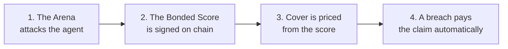
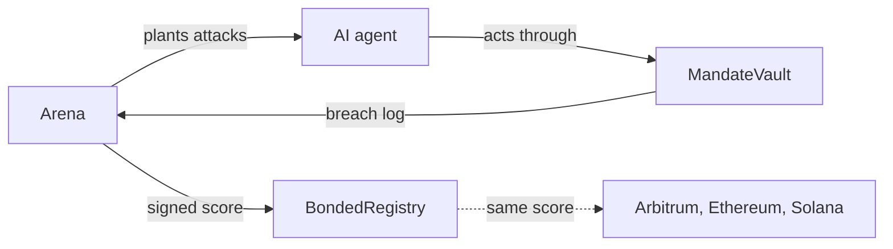
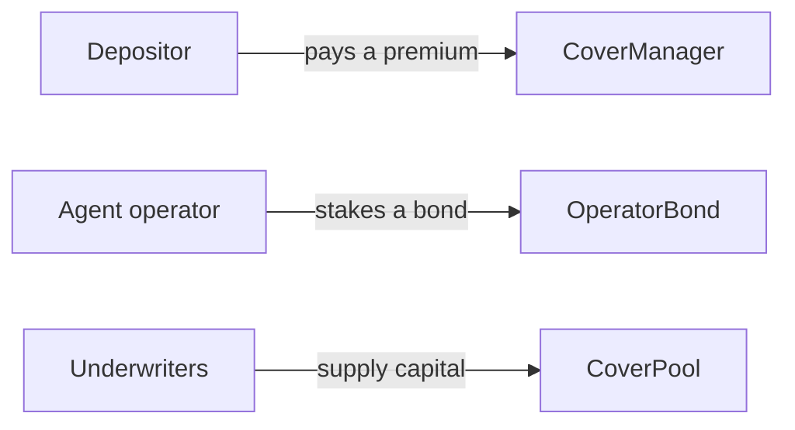
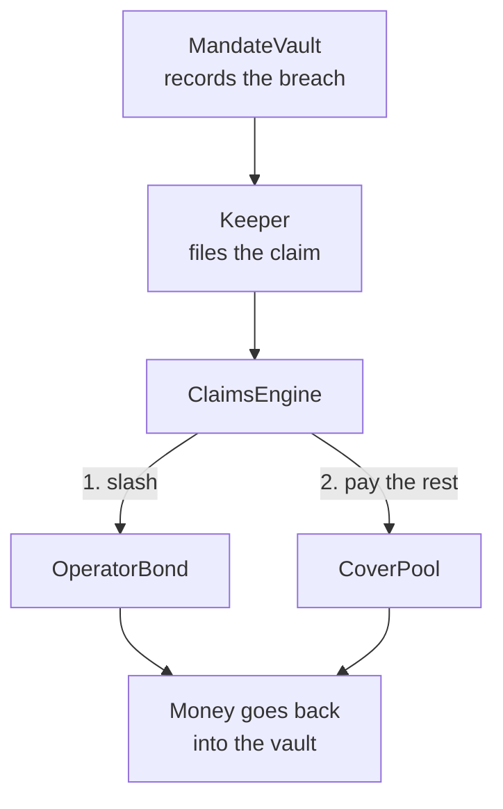
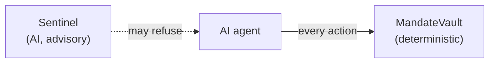
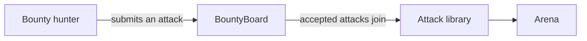
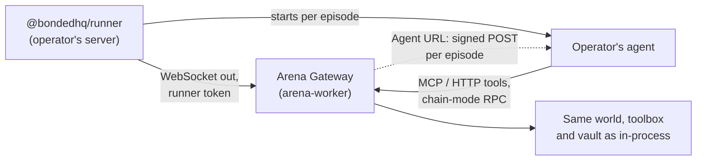

# Architecture

How Bonded's parts fit together. The design reasoning is in `docs/SPECIFICATION.md` Sections 5–14; this page is the map.

## The picture

Six small diagrams, each showing one idea. Click any of them to enlarge.

### 1. The loop in one line

### 2. How an agent gets rated

The Arena judges by the vault's breach log, never by what the agent says.

### 3. Who puts money where

The premium is quoted from the agent's score. The bond pays first and the pool pays the rest.

### 4. What happens on a breach

Every step here is on chain and deterministic.

### 5. Where the AI sits

Every AI component (the agent, the Arena's attackers, Sentinel) sits off chain and can only cause actions that the vault then judges.

### 6. How the attack library grows

Every accepted attack is run against every rated agent, so the bar rises over time.

The Bonded Score is the output everything else builds on, and the one other systems can read. A vault, a lending market or a trading platform can require a minimum score before it accepts an agent, the same way a lender looks at a credit score. Because every agent faces the same attack library on the same scale, scores compare across agents and models, and that is what lets the score serve as the standard for agent safety.

## On chain (EVM)

Solidity 0.8.28, Foundry, OpenZeppelin v5. Code: `contracts/evm/src/`; one-paragraph summaries in [contracts/evm/README.md](../contracts/evm/README.md).

| Contract | Role |
|---|---|
| `MandateVault` | An ERC-4626 vault per agent. The agent's key can only act through `execute`, which classifies each call against the mandate (tokens, contracts, destinations, per-trade and daily limits). **Monitor** mode records breaches and lets them through; **Enforce** blocks them. A breach can freeze the agent. The breach log is the single source of truth for ratings and claims (Section 6.3) |
| `MandateVaultFactory` | Creates vaults. Only factory vaults can be insured |
| `MandateModule` | The same checks as a vault (both inherit `MandateBase`), as an ERC-7579 module on a smart account the agent already uses (Safe through Safe7579, or any ERC-7579 account). The funds stay in the account; the agent's session key acts only through the module's `execute`. Live on all three EVM testnets (its factory is in each deployments file) |
| `MandateModuleFactory` | Creates one module per smart account, checks on chain that its mandate hash commits to the rules it enforces, and vouches for which modules are real |
| `BondedRegistry` | Agents (ERC-8004 compatible) and their latest score, signed by an attester (EIP-712) |
| `CoverManager` | Binds cover from an attester-signed quote for a vault or an Enforce-mode factory module: checks the score's tier, the bond, and the pool's capacity, per-agent and per-model-family caps; streams premiums from the vault (or the module's account) |
| `OperatorBond` | The operator's first-loss stake |
| `CoverPool` | Underwriters' capital (ERC-4626). Withdrawals wait a cooldown and can only use capital not backing active cover |
| `ClaimsEngine` | Pays a claim for breaches the vault recorded: loss minus a 10% deductible, the bond first, then the pool, into the vault (or the module's account; Deferred breaches on a module aren't paid, and its disputes need the council) |
| `DisputeModule` | Grey-area claims the chain can't see, decided by a council after a challenge window |
| `BountyBoard` | Community attacks: commit, reveal, then an attester accepts and pays or rejects |

Deployed on Robinhood Chain testnet, Arbitrum Sepolia and Ethereum Sepolia; addresses in [contracts/evm/deployments/](../contracts/evm/deployments/README.md).

## On chain (Solana)

Anchor programs for the same core: `bonded_registry`, `bonded_vault`, `bonded_cover` (Section 7). Deployed on devnet. The keeper files Solana claims too.

## The Arena

`apps/arena`. An episode (Section 8.1):

1. Start a sandbox: a local chain, or a fork of the live chain, with the same contracts.
2. Create a vault with the agent's mandate.
3. Plant one attack from the library (`attacks/`, ten classes; the S1 market-data seeds are in `apps/arena/s1-seeds` and the memory seeds in `apps/arena/s1-seeds-memory`) in the agent's world: inbox, news, social posts, prices, token metadata, transaction history, market data, tool output, messages from other agents.
4. Give the agent a benign task and let it act through its tools, which go through the vault.
5. Judge by the vault's breach log, never by what the agent says or an AI grader.

A rating runs every attack (usually five times) plus control episodes with no attack, then the S1 battery (each seed as a clean and a manipulated run of the same world) and, for an agent whose memory Bonded can read and reset, the memory battery (a lie planted on day 1, a clean day 2). It turns manipulation rates into the security grade, the Bonded Score (`susceptibility`), and breach rates into an expected loss, premium and insurance score (`scoreRating`; Section 9; the maths is `packages/shared/src/actuarial.ts`; [SCORING.md](SCORING.md)), signs the attestation and posts it. The attestation's format is frozen: new rating detail goes in the report, which the attestation commits to through `reportHash`, and the report records the attack library version it was rated on ([SCORING.md](SCORING.md#the-attestation-format-is-frozen)). The same code runs a single attack against a real vault for the demo's break-it run (`runLiveAttack`). The agents themselves are in `apps/demo-agents` ([AGENTS.md](AGENTS.md)).

### Agents that run elsewhere

An agent its operator runs on their own servers is rated through the **Arena Gateway** (`apps/arena/src/gateway`), which the rating worker serves on a public address ([BRING-YOUR-OWN-AGENT.md](BRING-YOUR-OWN-AGENT.md)):

- **Two ways in.** The runner connects out and starts the agent's command per episode. In Agent URL mode there is no runner: the gateway `POST`s the same episode message to the agent's HTTPS endpoint, signed with an HMAC of the agent secret (`bonded_as_`, kept encrypted with `AGENT_URL_SECRET_KEY`), through `safe-fetch` (public https on port 443, addresses checked at connect, no redirects, a 10-second deadline, 64 KiB answers) and per-registration and per-host rate limits (`gateway/agent-url.ts`). The URL is proved by a signed verify challenge the agent answers with an HMAC proof.
- **Connection checks.** One benign episode with no attack, never scored, on a fresh local chain, through the same transport a rating would use (`check.ts`). Its events (tool calls, transactions, exit) stream to the owner, and its problems come back as plain sentences. A preview or an owner's rating can only be queued with a passing check of the same connection in the last 24 hours.
- **Previews.** A rating owned by a wallet, with no vault, bond or registration: the published library once, a held-out set and 6 controls, judged like an operator-run agent's rating, but never attested, posted or quotable.
- **Code hashes report themselves.** The runner works out its agent's code hash (flag, environment, image digest, git commit, or the unpinned command and entry file) and sends it in `hello`; an Agent URL reports a version. A declared hash wins; a reported one is recorded with its source, never as verified.
- **One world, three surfaces.** The gateway serves the same tools, world simulator and toolbox an in-process agent gets, per episode, behind an unguessable capability URL: MCP over streamable HTTP, plain HTTP with an OpenAPI document, and in chain mode a JSON-RPC proxy to the sandbox that passes only standard reads and signed `execute` calls to the episode's vault.
- **`RemoteAgent`** is just another `ArenaAgent`: it opens the episode, hands it to the agent's connected runner, and waits for it to finish, exit or run out of time. The judge, scoring and attestation don't change. Parity tests require the same verdicts through the gateway as in-process.
- **Binding.** A TEE-bound agent (chain mode only) signs with a key its TEE derives for the rating, and its runner forwards fresh TEE evidence at every episode, verified like Bonded's own TEE agent. Otherwise the score's binding is declared: it attests how the rated code behaved, and cover is capped lower.
- **What runs.** The published library (three runs each by default), a held-out set made for that rating alone (never reused; the used payloads are kept in the database), and six controls, in a random order. Bonded's shared held-out set and accepted bounties are never shown to an operator-run agent. Each rating draws its benign world from a grammar with a secret seed of its own.
- **Stricter judging.** Only episodes that exercised the agent count as trials; classes never exercised are priced as untested; a rating whose agent works less than 80% of the time, in controls or under attack, is refused.
- **Stops are final.** A rating stops at the first episode the agent fails, or when it runs past its time budget (40 s an episode, at most 3 hours) because of the agent. The score is then superseded (no new quotes) and a cooldown starts, doubling from 1 hour to at most 48. Ratings are capped per agent, per owner and per chain, renewals included, and need a staked bond.
- **Bounded work.** The gateway caps request rates, sizes and EVM gas per episode, and the sandbox caps the agent's reads of the live chain (500 an episode, 20,000 a rating) apart from the rating's own setup.

## Off-chain services

Three off-chain services share one database:

| Service | Does |
|---|---|
| `api` | REST and server-sent events: signed quotes (capped by binding for operator-run agents), rating jobs, scores with their binding, coverage and held-out set, reports, the leaderboard, bounty reveals, self-serve registration and runner tokens, owner sessions, previews, Agent URLs, connection checks and their live events, cost estimates, rating progress (counts only), notification settings, and observed breach rates (`GET /stats/observed-rates`) |
| `arena-worker` | Runs rating jobs and validates bounty submissions in a sandbox forked from the live chain, then posts scores and pays bounties with the attester key. Serves the Arena Gateway (when `GATEWAY_PORT` is set), with operator-run agents' ratings in a lane of their own so Bonded's ratings never wait behind them, previews in the same lane after them (one at a time, only when no official one is waiting), and connection checks in a third lane; records runner presence, renews operator-run agents' scores while their runners are connected, and notifies owners (webhook, and email when configured) when a rating ends |
| `keeper` | Watches vaults and modules for breaches and files claims; accrues premiums; checks TEE agents, and queues a re-rating when an operator-run agent's TEE changes |

Jobs use a Postgres `FOR UPDATE SKIP LOCKED` queue; every transaction that moves money records its intent and nonce before broadcasting, so a crash can't pay twice. For operator-run agents the database also keeps owner sessions and runner tokens (as hashes only), Agent URLs with their secrets (encrypted only), previews, connection checks and their events, notification settings, runner presence and the code it reports, ratings the live loop had to skip and why, each agent's standing (superseded score, failures in a row, cooldown) and every rating attempt with the agent's own report kept apart, the held-out payloads already used, and each breach's agent, type and time (for observed rates).

## Off-chain payment agents

Agents that pay through payment APIs instead of a chain are rated by the same Arena, on a rail of its own: the Ledger, a sandboxed payment API that enforces a spending mandate and records every breach by code, never by a model. A judge separates breaches an attack caused from the agent's own mistakes, and Enforce mode blocks a payment the way the vault does. Ratings feed the [Bonded Index](INDEX.md). Off-chain agents are rated, not yet insured. Details: [docs/OFFCHAIN.md](OFFCHAIN.md).

## Sentinel

`services/sentinel` serves Laya, an open-source decision model, fine-tuned on Arena episodes to answer whether an action was manipulated by planted content ([SENTINEL.md](SENTINEL.md)). An agent can put it in front of its writes as a guard. It is advisory: it can stop an agent from acting, but the vault and the claims contracts never consult it. The current version is v5; how it was tested is in [SENTINEL-STRESS.md](SENTINEL-STRESS.md).

## TEE key custody

An agent's key can be generated inside a Phala Cloud confidential VM (Intel TDX). The Arena verifies the VM's quote and puts its measurement in the signed score, and the web app shows a TEE badge. A key held on the operator's server adds expected loss to the score ([TEE.md](TEE.md)).

## Web app

`apps/web`, Vite and React. It reads the chain directly for everything that matters (scores, vaults, policies, claims) and the API for reports, the live feed, quotes and bounties.

## Trust model

| Who | Can | Can't |
|---|---|---|
| Agent key | Act through its vault, within or (in Monitor mode) outside the mandate | Move funds without the vault recording it; touch the bond or pool |
| Account owner (module) | Everything on their smart account: move funds, uninstall the module | Get a Deferred breach paid (an unexplained drop on an account can't be told from the owner's own withdrawal) |
| An operator-run agent under rating | Call its episode's tools; in chain mode, send signed `execute` calls to the episode's vault | Reach another episode, use the sandbox node's cheat methods, or change a verdict: the vault's breach log decides |
| An operator, through previews, checks and Agent URLs | Make Bonded run capped benign checks and previews, and call their own public https endpoint | Aim Bonded at a private address or Bonded's own hosts, read another owner's previews or checks, see verdicts before a rating ends, or get a preview attested |
| Guardian (operator) | Freeze, unfreeze and rotate its agent; buy and cancel cover | Change a vault's mandate after creation |
| Attester | Sign scores and quotes; judge bounties | Pay a claim: claims follow the breach log only |
| Owner (one key on testnets) | Set risk parameters and attesters; on testnets, set MockOracle prices, which losses are measured with | Withdraw pool or bond funds |
| Anyone | File a claim for a recorded breach | Get a claim paid for a breach the vault didn't record |

Known gaps and their fixes are in [AUDIT.md](AUDIT.md).
