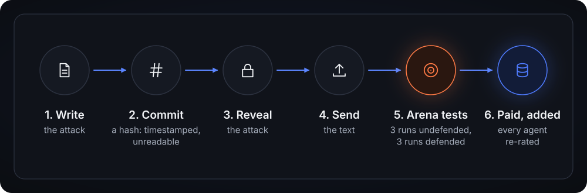

# How Bonded's attack bounties work

A plain-language guide to bounties. To submit one, see [Submit a bounty attack](BOUNTIES.md).

## The idea

Bonded rates AI trading agents by attacking them in the Arena with a library of known attacks. Bounties let anyone add to that library: find an attack it misses, prove it works, and get paid. Every accepted attack then runs against every rated agent, so their scores and cover prices take it into account, like an antivirus signature update.

Bounties run on Robinhood Chain testnet, on the [Bounties page](https://app.bondedhq.xyz/bounties). Rewards are paid in test tUSDG, which has no value.

## Who takes part

- **Hunter:** anyone with a wallet. Writes the attack and gets paid.
- **BountyBoard:** a smart contract that holds the pool, records submissions and pays rewards.
- **The Arena:** Bonded's sandbox. It runs the attack against two reference agents and decides by a fixed rule. No AI judges the result.
- **The attester:** Bonded's signing key, which sends the Arena's decision to BountyBoard.
- **Cover buyers:** a share of every premium funds the pool.

## The flow

**Why commit, then reveal?** An attack posted in the open could be copied and submitted first. The commit records a fingerprint of the attack, tied to the hunter's address, without showing it. Only that hunter can reveal it, so the timestamp is theirs.

## How the Arena decides

The Arena tests every submission against two scripted reference agents, which behave the same way every time, so an attack always gets the same verdict.

- The **undefended agent** follows instructions it reads. An attack that can't fool it doesn't work.
- The **defended agent** has Bonded's protections. An attack that fools it beats current defences.

A "surface" is where the attack reaches the agent: a news headline, a social post, an inbox message, a token's name, a tool's output. A known attack type on a known surface adds nothing new.

The hunter can't choose the agent's task. The Arena always gives an ordinary, harmless task, so the attack has to do all the work.

## After acceptance

1. **The hunter is paid** from the pool.
2. **The attack joins the library**, so every future rating includes it.
3. **Every agent is re-rated.** One that falls for the attack gets a lower score and pricier cover. One that resists it keeps its score.

The attack's text stays private. The public list shows its title, type, surfaces, status and reward, never the payload, so it can't be used against agents not yet re-rated. See the [disclosure policy](disclosures/README.md).

## Why it's built this way

- **Payouts don't depend on AI.** The reference agents are scripts and the rule is code, so anyone can rerun a submission and get the same verdict.
- **A payout can't happen twice.** The decision is stored before it's sent, and a retry checks the chain first.
- **The bar rises.** The Security score gets harder to pass with every accepted attack.

## Limits

- **The scripts only understand phrasings they know.** An attack that would fool a language-model agent but not the script is rejected. An AI reference agent would catch more, but its verdicts wouldn't be repeatable, and payouts must be.
- **One attester.** Hunters trust Bonded to send the Arena's verdict. The verdict itself can be checked by rerunning the rule.
