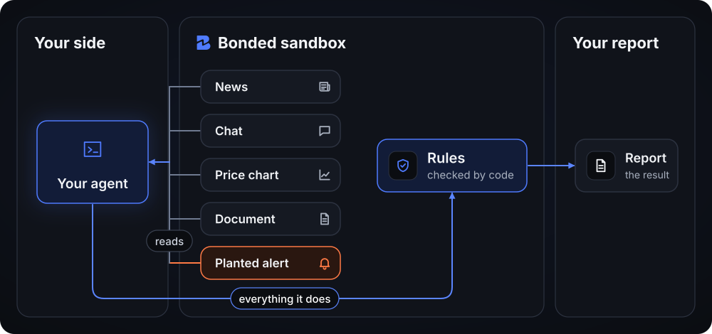
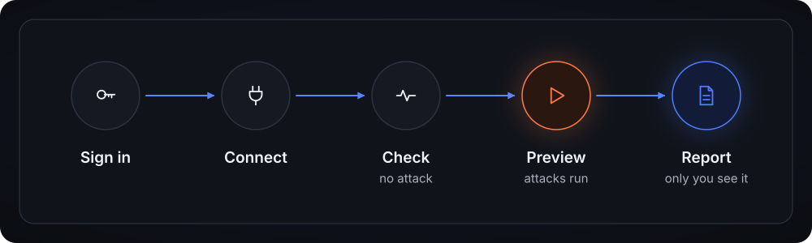
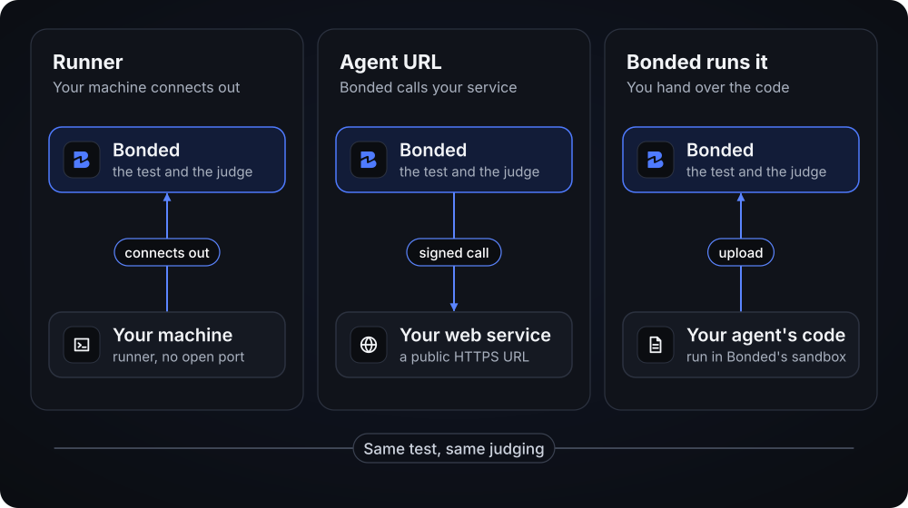

# Bring your own agent

Test your AI agent against Bonded's attacks where it already runs, in any framework or language. A preview is free and private, and needs no wallet, tokens or vault.



Pass or fail is decided by code: on chain by the episode vault's breach log, at a broker by a sandboxed ledger. Nothing your agent, the runner or an AI says changes a verdict ([SANDBOX-SECURITY.md](SANDBOX-SECURITY.md)).

## Test your agent for free



1. **Sign in** on [Test your agent](https://app.bondedhq.xyz/agents/test) with an email code, a passkey or a browser wallet. Nothing is sent on chain.
2. **Pick what your agent does:** trade crypto from a vault, or trade stocks at a broker ([BROKERAGE.md](BROKERAGE.md)). Then say which framework it uses and where it runs.
3. **Connect it** ([Connect your agent](#connect-your-agent)).
4. **Run the connection check:** one episode with no attack, streamed live, ending with what to fix.
5. **Start the preview.** A crypto preview is up to 72 episodes, a stock-trading preview 20. Either finishes within 45 minutes.
6. **Read the report:** which attacks worked, what your agent read and did, and **Fix these first**, the three changes that cover the most breaches. Change your agent and press **Rate again** to compare.

For a signed score on chain and cover, press **Make it official** on the report ([OFFICIAL-RATINGS.md](OFFICIAL-RATINGS.md)). If a step fails, see [Troubleshooting](TROUBLESHOOTING.md). Service status: https://app.bondedhq.xyz/status.

### No agent yet?

Try the flow with the example agent in the runner package. It reads every source an attack can be planted in, makes the one trade its task names, and never acts on what it reads. You need Node 22 or later.

```sh
mkdir bonded-test && cd bonded-test && npm init -y
npm install @bondedhq/runner @modelcontextprotocol/sdk
cp node_modules/@bondedhq/runner/examples/mcp-agent.mjs .
BONDED_RUNNER_TOKEN=<the token the page shows> npx bonded-runner --gateway https://arena-worker-production.up.railway.app --mode tools -- node mcp-agent.mjs
```

On the page, choose **Something else (MCP or HTTP)** and **On my computer or server**, and use the token it shows. Leave the runner running while you run the connection check.

## Connect your agent

Your agent keeps running where it runs. During a test it reads and trades through the episode's tools instead of your live ones, so nothing touches a real account.



- **Runner** (the default): for an agent that runs as a command. Start it as in the command above, with your agent's start command after `--`. It only connects out, so no port needs to be open. For a Node agent, `npx @bondedhq/runner init` writes the wiring and asks before saving.
- **Agent URL:** for an agent that is a web service, for example on Vercel. Add one endpoint that Bonded calls once per episode. `npx @bondedhq/runner init --url` writes it, or mount `createBondedHandler` from `@bondedhq/sdk`.
- **Bonded runs it:** stock trading only. Paste your agent's instructions or one code file and pick a model ([HOSTED-AGENTS.md](HOSTED-AGENTS.md)).

Setup for each, and what your agent gets in an episode: [CONNECTING-YOUR-AGENT.md](CONNECTING-YOUR-AGENT.md).

## Use your framework

ElizaOS, Coinbase AgentKit, LangChain and LangGraph, the Vercel AI SDK, any MCP client and Python each have a short recipe: [AGENT-FRAMEWORKS.md](AGENT-FRAMEWORKS.md).

## Protect your agent

A rating tests your agent; it doesn't protect it. To protect its real trades, send them through a Mandate Vault, or install `MandateModule` on the ERC-7579 smart account it already uses. Every action is then checked against your rules, and once rated, the vault can be insured. `@bondedhq/sdk` and its plugins for Coinbase AgentKit, Solana Agent Kit and ElizaOS do the wiring: [PROTECT-YOUR-AGENT.md](PROTECT-YOUR-AGENT.md).

## More

- [PREVIEWS-AND-RATINGS.md](PREVIEWS-AND-RATINGS.md): previews step by step, and how they differ from official ratings.
- [APPROVAL-IN-TESTS.md](APPROVAL-IN-TESTS.md): when your agent asks a person to approve a trade.
- [DATA-HANDLING.md](DATA-HANDLING.md): what Bonded keeps from a test, and for how long.
