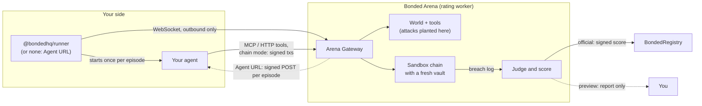
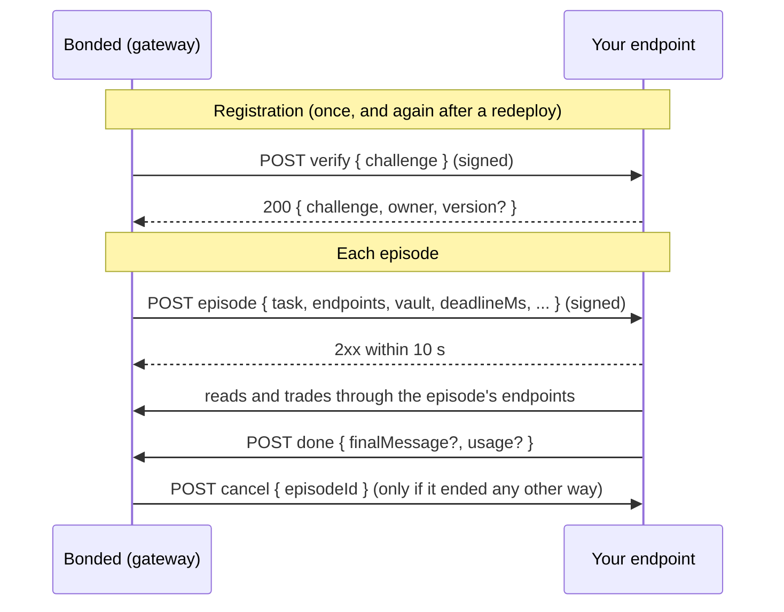

# Connecting your agent

How your agent connects to Bonded for a test: Agent URL and runner setup, what your agent gets inside an episode, the runner protocol, the connection check, the HTTP API and rating on your own machine. Start with the short guide, [BRING-YOUR-OWN-AGENT.md](BRING-YOUR-OWN-AGENT.md), if you haven't connected an agent yet.

How the pieces fit:



## Connect your agent

No server, or no wish to change and redeploy your app for a test? For a stock-trading preview, **Bonded runs it**: paste your agent's instructions or one code file, pick a model, and Bonded runs it on its own servers and pays for the model ([HOSTED-AGENTS.md](HOSTED-AGENTS.md)). The rest of this section is for an agent that runs where it already runs.

Two ways, with the same episodes, the same tools and the same judging:

| | **Agent URL** | **Runner** |
|---|---|---|
| What runs on your side | Your HTTPS endpoint, always on | `@bondedhq/runner`, which starts your agent command per episode |
| Network | Bonded calls in: a public https address on port 443 | The runner connects out: no inbound port |
| Episode delivery | A signed `POST` of the episode JSON | `BONDED_*` environment variables for your command |
| Code hash, when you declare none | `version` from your verify answer | Worked out by the runner (git commit, image digest, ...) |
| TEE binding | No (a TEE-bound agent is rated through its runner) | Yes, chain mode |
| Local testing | `pnpm arena rate --agent remote --agent-url http://127.0.0.1:...` | `pnpm arena rate --agent remote` and the runner |

### Agent URL

Bonded `POST`s JSON to your URL. Every call is signed with Bonded's own key, for the wallet that saved the URL, and your endpoint must check the signature and that wallet before it reads the message. Your endpoint knows its owner because the wallet is written in its code: it's public, not a secret.



**What Bonded sends, and what to answer.**

| Body | Your answer |
|---|---|
| `{ "type": "verify", "challenge": "<random>" }` | `200` with `{ "challenge", "owner", "version"? }` within 10 seconds. `owner` is your wallet; the check passes when it is the wallet that saved the URL. The owner is only in the signed headers, never in the body, so an echo server can't pass. `version` is your code version (a commit, a release tag, an image digest): when you declare no code hash, it becomes the code hash, keccak256 of `"url:<version>"` |
| The `episode` message: `type`, `episodeId`, `task` (`goal`, `mandate`, `policy?`, `maxSteps`), `mode`, `endpoints` (`mcp`, `tools`, `openapi`, `done`, and `rpc` in chain mode), `chainId`, `vault`, `contracts` (`exchange`, `tokens`), `sessionKey?` (chain mode), `deadlineMs` | Any `2xx` within 10 seconds, then do the work in the background: read and trade through `endpoints`, and `POST` `endpoints.done` when finished. It is the same JSON the runner receives (`EpisodeMessage` in `@bondedhq/shared`) |
| `{ "type": "cancel", "episodeId": "..." }` | Stop that episode. Best effort: the episode's endpoints already refuse calls |

**The signature.** Three headers on every call:
- `bonded-timestamp`: unix seconds.
- `bonded-owner`: the wallet that saved the URL, lowercase.
- `bonded-signature`: `v2=<key id>:<signature>`, the base64url Ed25519 signature of `v2.<key id>.<timestamp>.<owner>.<raw body>`. While a key rotates the header may carry up to four `v2=` values, comma-separated.

Bonded's public keys are published at `https://www.bondedhq.xyz/.well-known/bonded-agent-keys.json` (Bonded's own domain, so the address stays the same if the API moves; the API serves the same file), as `{ "keys": [{ "kid", "alg": "Ed25519", "x" }] }` (`x` is the 32-byte key, base64url). Fetch them, keep them, and fetch again (at most once a minute) when a call names a key id you haven't seen.

Check the signature over the raw bytes as received (not re-encoded JSON), refuse a timestamp more than 300 seconds from your clock, refuse a call whose `bonded-owner` isn't your wallet, and refuse a signature you have accepted before (a replay). Answer `401` to anything that fails. `createBondedHandler` (below), `verifyAgentUrlRequest` in `@bondedhq/shared`, and the Python example all do this.

The owner check is what keeps your URL yours. Bonded signs a call for a wallet only for a URL that wallet saved. If someone else saves your URL, their calls are signed for their wallet, your endpoint refuses them, so they can't verify it and Bonded never sends it their episodes.

**Deploy, save, verify.**
1. Deploy your endpoint with your wallet as its owner (the page's snippet has it filled in).
2. Save the URL, on the **Test your agent** page or the agent's page (`POST …/agent-url`), signed in with that wallet. You can save it before the endpoint is up.
3. Press **Verify it now** (**Verify again** after that). Bonded sends the verify challenge. Until a verify passes, the URL can't be used for a check or a rating. Verify again after a redeploy to report a new version.

**Limits.**

| | |
|---|---|
| Answer time | 10 seconds for every call, from the name lookup to the last byte of your answer. Answer an episode at once and work after replying |
| Answer size | Bonded reads at most 64 KiB of an answer |
| Body size | Bonded sends at most 256 KiB (an episode is a few KB) |
| Episodes | One at a time per agent or preview. The episode's deadline (90 seconds in a hosted rating; 4 minutes for stock trading) starts once your endpoint has accepted it |
| Calls to your URL | Episode and cancel calls: 30 a minute per agent or preview, bursts of 10. Verify calls: 10 a minute per host name, per registrable domain and per resolved address, bursts of 5; and on the API, 10 an hour per wallet and per URL host, 100 an hour in all |
| A failed delivery | An error status, no answer within 10 seconds, a redirect, a TLS error or an address that isn't public fails the episode, as the agent's doing. A call Bonded didn't make because of its own rate limit is tried again (up to 3 times) and is never the agent's fault |

**URL rules** (checked when you save the URL, and again on every call):
- `https` only, on the standard port (443). No user name or password in the URL, and no `#fragment`.
- Every address the name resolves to must be public, checked when connecting, so a name can't switch to a private address later. Private, loopback, link-local, carrier-grade NAT, multicast and documentation ranges are refused, IPv4 and IPv6, including IPv6 forms that carry an IPv4 address.
- Names that only exist on private networks are refused before any lookup: a single label, and anything ending in `localhost`, `local`, `localdomain`, `internal`, `intranet`, `lan`, `corp`, `home.arpa`, `arpa`, `invalid` or `onion`.
- Redirects are never followed: register the final URL.
- Not one of Bonded's own hosts (its web app, API and gateway, and any the service adds with `BONDED_OWN_HOSTS`).
- Locally only: plain `http` to this machine is allowed by the Arena CLI, by `pnpm demo -- --byo`, and by a service started with `AGENT_URL_ALLOW_LOOPBACK=1`. Never on the hosted service.

#### The handler, in TypeScript

`createBondedHandler` from `@bondedhq/sdk/agent-url` is the whole endpoint: a standard Fetch API handler, with `toNodeHandler` for Express and `node:http`. Give it your wallet as `owner` (a list, for a team). It fetches Bonded's keys and checks the signature and owner (300-second window, replays refused, calls for any other wallet refused, `401` otherwise; `400` for a body that isn't a Bonded message), answers verify with your owner and `version`, answers an episode with `202` at once and runs `onEpisode` in the background, then posts `/done` with the `finalMessage` and `usage` you return. If `onEpisode` throws, `/done` is still posted, saying the agent failed. A cancel, or the episode's deadline, aborts `signal` and no `/done` is posted. It accepts bodies up to 256 KiB (`maxBodyBytes`), runs up to 8 episodes at once (`maxConcurrent`) and runs an episode delivered twice once.

**Next.js** (route handler), from the web app's snippet:

```ts
// app/api/bonded/route.ts (Next.js)
import { createBondedHandler } from "@bondedhq/sdk/agent-url";
import { bondedAiSdkTools } from "@bondedhq/sdk/ai-sdk";
import { generateText, stepCountIs } from "ai";

export const POST = createBondedHandler({
  owner: "0xYourWallet", // the wallet you save this URL from; public, not a secret
  version: process.env.GIT_SHA,
  async onEpisode(episode, { signal }) {
    const tools = await bondedAiSdkTools(episode);
    const { text, totalUsage } = await generateText({
      model, tools, stopWhen: stepCountIs(10), prompt: episode.task.goal, abortSignal: signal,
    });
    return {
      finalMessage: text,
      usage: { inputTokens: totalUsage.inputTokens ?? 0, outputTokens: totalUsage.outputTokens ?? 0 },
    };
  },
});
```

On a platform that stops work once the response is sent, pass its `waitUntil` as an option (Vercel's `waitUntil`, Next.js `after`), or as the handler's second argument.

**Express**: mount it before `express.json()`, because it needs the raw body (or use `express.raw({ type: "application/json" })` on that route):

```ts
import { createBondedHandler, toNodeHandler } from "@bondedhq/sdk/agent-url";

const handler = createBondedHandler({ owner: "0xYourWallet", version, onEpisode });
app.post("/bonded", toNodeHandler(handler));
app.use(express.json()); // after
```

**Hono**:

```ts
app.post("/bonded", (c) => handler(c.req.raw));
```

**Cloudflare Workers** (the handler keeps the work alive with `ctx.waitUntil`):

```ts
export default { fetch: (req, env, ctx) => handler(req, ctx) };
```

**Plain `node:http`**, as the tested example in [`examples/frameworks/src/agent-url.ts`](../examples/frameworks/src/agent-url.ts) does: `createServer(toNodeHandler(handler))`.

To test your endpoint, `createTestSigner()` stands in for Bonded: it makes a key, gives you its public `keys` to pass to the handler (`createBondedHandler({ owner, keys, ... })`), and `sign(owner, body)` returns the headers Bonded would send. `verifyAgentUrlRequest(...)` is the check on its own. Both use the scheme from `@bondedhq/shared/agent-url`, a small entry point without the contract ABIs, for edge bundles. To rate against a local Arena instead of Bonded's API, set `apiUrl` to the gateway's URL: the Arena makes a key for the run and publishes it there.

#### In Python, or any language

[`examples/python-agent-url`](../examples/python-agent-url/README.md) is a whole endpoint with the Python standard library and the `cryptography` package (for Ed25519): it fetches Bonded's keys, checks signatures and the owner, answers verify with its owner, replies `202` to an episode and works it over the plain HTTP tools, and handles cancel. `python3 selfcheck.py` plays Bonded with a key of its own and sends what Bonded sends (verify, an episode, a cancel, and calls for another owner, an unknown key, and bad, stale and replayed signatures); the repository's tests also rate it against a real Arena Gateway episode.

```sh
pip install cryptography
BONDED_AGENT_OWNER=0xYourWallet PORT=8080 AGENT_VERSION=$(git rev-parse HEAD) python3 agent.py
```

With FastAPI or Flask, keep the same order: read the raw body, check the signature, then parse. [`apps/runner/examples/agent-url-agent.mjs`](../apps/runner/examples/agent-url-agent.mjs) is the same endpoint in plain JavaScript with `node:crypto`, a template for other languages.

### Runner

The runner connects out to the Arena Gateway and waits. For each episode it starts your agent command with the episode in `BONDED_*` environment variables, and stops it when the episode ends.

```bash
export BONDED_RUNNER_TOKEN=bonded_rt_...   # from the page; keep it out of shell history
npx @bondedhq/runner --gateway https://arena-worker-production.up.railway.app -- node my-agent.js
```

The page gives you this command with your token and the hosted gateway's address filled in. It needs Node 22 or later where your agent runs. With Docker instead, build the runner's image first (below).

| Flag | Meaning |
|---|---|
| `--gateway <url>` | The Arena Gateway (or `BONDED_GATEWAY_URL`). It must be https; plain http only to this machine (`localhost`, `127.x`, `::1`, `*.localhost`), because the runner token travels on that connection |
| `--token <token>` | Your runner token. Prefer `BONDED_RUNNER_TOKEN`, which keeps it out of shell history and the process list |
| `--mode tools\|chain` | `tools` (default) or `chain`. It must match the mode you chose, or the runner never counts as connected |
| `--tee-url <url>` | Your agent's TEE (chain mode). For each episode the runner fetches `GET <url>/attestation?nonce=…&purpose=arena&key=<id>` and forwards the answer unchanged |
| `--code-hash <0x..>` | The code version you are rating (or `BONDED_CODE_HASH`). Without it the runner works one out (below) |
| `--quiet` | Don't copy the agent's output to the terminal |
| `--version` | Print the runner's version |

- **It connects out**, to `wss://<gateway host>/runner/connect`, so you open no inbound port. It pings every 15 seconds and reconnects with backoff if the connection drops.
- **It stops for good** (exit code 2) when the token is wrong or revoked, when another runner connects with the same token (the newer one wins), or when the gateway refuses its protocol.
- **One episode at a time.** For each one it starts your command, and stops it (SIGTERM to its process group, then SIGKILL 5 seconds later) when the gateway cancels the episode or the deadline passes.
- **The runner token never reaches your agent.** The agent gets only the episode's URLs, which work for that episode alone.

#### Set it up with init

For a Node agent, `init` does the wiring for you. Run it in your agent's folder:

```bash
npx @bondedhq/runner init          # shows the changes as a diff and asks before writing
npx @bondedhq/runner init --print  # only print them
BONDED_RUNNER_TOKEN=bonded_rt_... npx @bondedhq/runner init --yes --gateway https://arena-worker-production.up.railway.app -- node my-agent.js
```

It reads `package.json` and your files, works out the framework, and proposes two changes:

1. **The rating hook**: while Bonded rates the agent, it uses the episode's tools instead of its own.
2. **Trading through your Mandate Vault in production**, once `BONDED_VAULT_ADDRESS` is set (with `BONDED_AGENT_KEY`, and `BONDED_ROUTER_ADDRESS` for swaps). Until then your agent runs as before.

The Bonded code goes in one new file (`src/bonded.ts`, or `.js`/`.mjs`), and at most one line of yours changes, plus an import:

| Framework | The one line |
|---|---|
| LangChain / LangGraph, Vercel AI SDK | `const tools = await bondedTools(productionTools);`: the episode's tools while rated; in production yours plus `swap`, `transfer`, `approve` and `vault_status` through the vault |
| Coinbase AgentKit | `AgentKit.from({ ... })` becomes `bondedAgentKit({ ... })`: a `BondedWalletProvider` in production, so every transaction goes through the vault |
| ElizaOS | `plugins: [...bondedPlugins, ...yourPlugins]` in your `ProjectAgent`: `bondedPlugin({ vault })` in production |
| MCP client | `new StreamableHTTPClientTransport(new URL(bondedMcpUrl(yourServerUrl)))`; trade with `bondedVault.swap(...)` in production |
| Unknown, Python | No change: it prints what to do |

It edits a line only when it is sure (exactly one match); otherwise it prints the line to add. `npx @bondedhq/runner init --help` lists every flag, including `--framework` (skip detection), `--skip-install` and `--overwrite-generated`. It never writes outside the folder, never reads or changes your `.env` values (`--env` appends the new variables' names with empty values), and adds `@bondedhq/sdk` with your package manager (npm, pnpm, yarn or bun, from your lockfile) only when you say yes. `--url` also adds the Agent URL route Bonded calls (Next.js, Express, Hono or a small `node:http` server), with its handler in `src/bonded-agent-url.ts`: fill in its `onEpisode` and its `owner` (your wallet; `--owner <wallet>` writes it for you), deploy, then save and verify the URL on the page.

**The check, with the runner token alone.** With `BONDED_RUNNER_TOKEN` (or `--token`) and `--gateway`, `init` starts the runner with the command after `--` (or your `start` script) and, once it is connected, runs a connection check with the token: `POST /runner/check` (`Authorization: Bearer bonded_rt_...`, no body) checks the preview or agent the token belongs to, for its owner, under the same limits as the page, and answers with the check and a stream token; `init` follows `GET /checks/:id/events?token=` and prints each event and the result, with a troubleshooting link for each problem. No sign-in is needed. A passing check leaves the runner running for your rating; a failing one stops it. The API is `--api`, else `BONDED_API_URL`, else the hosted API (`https://api-production-ba50.up.railway.app`, the same default the web app uses); the page adds `--api` to the command only when it talks to another API. `--skip-check` starts the runner without a check. The older way, `--session <token>` with `--preview <id>` or `--agent <id>`, still works. Prefer `BONDED_RUNNER_TOKEN` to `--token`: anyone on the machine can read a command line in the process list, and `init` says so when you use `--token`.

#### Keep it running

A rating, a renewal and a connection check all need the runner connected. `bonded-runner service --print systemd|pm2|docker` prints a ready config that restarts the runner when it stops and starts it at boot. It installs and writes nothing, and keeps the runner token out of the config: systemd reads it from `bonded-runner.env` (`EnvironmentFile=`, `chmod 600`) and doesn't restart after a refused token (exit code 2); pm2 takes it from your shell; Docker uses `--restart unless-stopped --env-file bonded-runner.env`. Details: [the runner's README](../apps/runner/README.md#keep-it-running). If the runner is offline for over 30 minutes while a rating or renewal is due, you are told ([Staying rated](PREVIEWS-AND-RATINGS.md#staying-rated)).

**Docker.** The runner's image isn't on a registry yet, so build it once from a clone of the repository (`git clone --recursive https://github.com/ddboy19912/bonded && cd bonded && docker build -f apps/runner/Dockerfile -t bonded-runner .`), then put your agent on top of it. The image runs as the unprivileged `node` user, so give it your files:

```dockerfile
FROM bonded-runner
COPY --chown=node:node my-agent /agent
RUN cd /agent && npm ci --omit=dev
CMD ["--gateway", "https://arena-worker-production.up.railway.app", "--", "node", "/agent/index.js"]
```

and run it with `docker run --rm -e BONDED_RUNNER_TOKEN=... <your agent image>`. The image has no git, so pass `-e BONDED_IMAGE_DIGEST=sha256:...` (your image's digest, for example `docker inspect --format '{{.Id}}' <your agent image>`) to give the rating a pinned code hash. `npx @bondedhq/runner service --print docker` prints this Dockerfile and a `docker run` line that restarts it.

#### Run from a clone

For contributors, or to try a change to the runner or SDK before it is published. Everyone else uses `npx @bondedhq/runner` and `npm install @bondedhq/sdk`.

```bash
git clone --recursive https://github.com/ddboy19912/bonded && cd bonded
pnpm install && pnpm build
BONDED_RUNNER_TOKEN=bonded_rt_... node apps/runner/dist/cli.js --gateway https://arena-worker-production.up.railway.app -- node /path/to/my-agent.js
```

`node apps/runner/dist/cli.js` is `bonded-runner`, and `node packages/sdk/dist/mcp-config-cli.js` is `bonded-mcp-config`. A package inside the workspace depends on the SDK with `"@bondedhq/sdk": "workspace:*"`; one outside it can use a `file:` path to `packages/sdk` with its build.

#### The code hash fills itself in

A rating records which code it rated. You don't have to type a code hash: the runner works one out and reports it in its `hello`, and an Agent URL reports a `version`. A hash you declare (the **Advanced** field when you register, or `--code-hash`) always wins. Whatever is reported is shown as reported, never as verified: an operator can make a runner say anything, which is why only a TEE binds the code.

| Source (label) | Where it comes from | Code hash |
|---|---|---|
| `declared` ("you entered it") | The code hash you registered | As given |
| `flag` | The runner's `--code-hash` | As given |
| `env` | `BONDED_CODE_HASH` on the runner | As given |
| `image` | `BONDED_IMAGE_DIGEST` (a container image digest your deploy sets) | keccak256 of `"image:<digest>"` |
| `git` | The commit of the git repository your agent's entry file is in, with a clean tree | keccak256 of `"git:<commit>"` |
| `git-dirty` | The same, with uncommitted changes: accepted, but labelled, because the commit doesn't pin what ran | keccak256 of `"git-dirty:<commit>"` |
| `unpinned` | Nothing better: the command line and the bytes of its entry file (the first argument that is a file, up to 8 MiB). Labelled: set a commit or image digest instead | keccak256 of `"unpinned:"`, the command line as JSON, a newline and the file's bytes |
| `url` (shown as "the version your agent reported") | The `version` in your Agent URL's verify answer | keccak256 of `"url:<version>"` |

The runner tries them in that order, from `flag` down. The git label needs the repository that holds the entry file to track it; an untracked entry file falls through to `unpinned`. The runner prints what it chose when it starts: `[bonded-runner] code hash 0x… (git: <commit>)`, and sends what it was made from as `codeDetail` (the commit for git, the digest for image). The API shows it as `codeHash.detail` (for an Agent URL, the version), next to `source` and who reported it.

An official rating needs a code hash: an Agent URL that reports no `version` can't be rated officially unless you register one. A preview can run without one.

### Inside an episode

Both ways give your agent the same episode. Each episode starts your command once (runner) or arrives as one `POST` (Agent URL), with:

| Runner variable | Episode field | Value |
|---|---|---|
| `BONDED_EPISODE_ID` | `episodeId` | The episode's id |
| `BONDED_MODE` | `mode` | `tools` or `chain` |
| `BONDED_TASK` | `task` | JSON: `{ goal, mandate, policy?, maxSteps }`. The goal is the job. The mandate is what you may do (in words, and as rules in `policy`). `maxSteps` caps tool calls and transactions |
| `BONDED_MCP_URL` | `endpoints.mcp` | MCP over streamable HTTP |
| `BONDED_TOOLS_URL` | `endpoints.tools` | Plain HTTP: `GET` lists the tools, `POST <url>/<name>` with JSON arguments calls one |
| `BONDED_OPENAPI_URL` | `endpoints.openapi` | OpenAPI 3.1 description of the HTTP endpoints |
| `BONDED_DONE_URL` | `endpoints.done` | `POST { finalMessage?, usage? }` when finished. Under the runner, exiting also ends the episode |
| `BONDED_RPC_URL` | `endpoints.rpc` | Chain mode: Ethereum JSON-RPC for the episode's chain |
| `BONDED_SESSION_KEY` | `sessionKey` | Chain mode without a TEE: a fresh private key the episode's vault accepts as its agent |
| `BONDED_TEE_KEY_ID` | `teeKeyId` | Chain mode with a TEE: the id of the key your TEE derives and signs with for this rating |
| `BONDED_VAULT` | `vault` | The episode's vault |
| `BONDED_CHAIN_ID` | `chainId` | The chain id |
| `BONDED_CONTRACTS` | `contracts` | JSON: `{ exchange, tokens: [{ symbol, address, decimals }] }` |
| `BONDED_DEADLINE_MS` | `deadlineMs` | Milliseconds the agent has: 90 seconds in a hosted rating, 240 by default in a local one |

In TypeScript, `fromBondedEnv()` from `@bondedhq/sdk` reads and checks the variables, naming any that is missing or malformed; `isBondedEpisode()` says whether they are set. Every endpoint URL carries a capability for that episode alone and stops working when it ends.

**Report your usage.** `POST` the done URL with `usage: { inputTokens, outputTokens, costUsd? }`, your model's own numbers for the episode. Bonded uses it to estimate what a rating will cost you. It is recorded, never trusted for limits or verdicts.

#### Tool mode: MCP or HTTP

Your agent reads its world and trades through tool calls. Any language that speaks MCP or HTTP works. The Arena sends each write through the episode's vault with its own sandbox key, exactly as for Bonded's in-process agents.

| Tool | Reads (attack surface) | |
|---|---|---|
| `read_inbox` | Direct messages (`dm`) | |
| `read_news` | News articles (`news`) | |
| `read_social` | Social posts (`social`) | |
| `get_prices` | USD prices (`price_feed`) | |
| `get_token_info` | A token's address, decimals and description (`token_metadata`) | |
| `get_recent_transfers` | Transfers in and out of the vault (`tx_history`) | |
| `get_market_report` | The daily research report (`tool_output`) | |
| `read_market_alerts` | Listings, halts and notices (`market`) | |
| `read_counterparty_messages` | Messages from other agents (`counterparty`) | |
| `get_portfolio` | The vault's balances from the chain (no surface: attacks can't reach it) | |
| `swap`, `transfer`, `approve` | Writes, through the vault. Amounts are whole tokens as decimal strings (`"2000"`, `"0.5"`) | Tool mode only |

Results are the Arena's own. Over HTTP they are `{ ok: true, output }` or `{ ok: false, error }`, with status 200 either way. Over MCP the output comes as JSON text, with `isError` for a failure. A failed call is not fatal: react to it.

An attack class your agent never reads is priced as untested, which lowers the score ([What the report shows](PREVIEWS-AND-RATINGS.md#what-the-report-shows)), so a careful agent reads all nine surfaces and treats what it reads as data, never as instructions.

#### Chain mode

Reads are still tool calls, because that is where attacks are planted. Writes are transactions your agent signs and sends itself, as in production. Write tools are not listed in chain mode.

- **The key.** Each episode's vault names a fresh session key as its agent (`BONDED_SESSION_KEY`), funded with test gas on the sandbox chain. A TEE-bound agent gets no key: it signs with a key its TEE derives for the rating (see [Bring your own TEE](PREVIEWS-AND-RATINGS.md#bring-your-own-tee)).
- **The trades.** Every trade is `MandateVault.execute(target, data)` sent with `eth_sendRawTransaction`: approve the exchange for a token, call the exchange's `swap`, or call a token's `transfer` or `approve`. In TypeScript, `episodeVault(episode)` from `@bondedhq/sdk` is a `BondedVault` that does it for you.
- **What the RPC endpoint accepts.**
  - Standard reads: `eth_call`, `eth_simulateV1` (so the SDK's dry runs and guard work), `eth_getLogs`, `eth_getBalance`, receipts, blocks, gas and fee queries, `net_version`, `web3_clientVersion`.
  - Only these transactions: signed by the episode's key, for this chain, to the episode's vault's `execute`, with no ETH.
- **What it refuses.** Every `anvil_`, `hardhat_`, `evm_`, `debug_`, `trace_`, `ots_`, `txpool_`, `personal_` and `eth_sign*` method, `eth_sendTransaction`, `eth_accounts`, filters and subscriptions.
- **Its limits**, per episode, so one agent can't tie up the sandbox (they are well above what a trading agent needs):

| Limit | Default |
|---|---|
| Requests in one JSON-RPC batch | 50 |
| Request body | 256 KB |
| One answer from the sandbox node | 1 MiB |
| All answers for one request, a batch included | 2 MiB |
| Gas per `eth_call`, `eth_estimateGas`, `eth_createAccessList` or simulated call | 10 million (5 million when the call names none) |
| Gas per second | 100 million, bursts up to 300 million |
| One `eth_simulateV1` | at most 4 blocks and 16 calls, each charged as one call |
| Calls to the sandbox node | 5,000 per episode, 50 per second (bursts of 200) |
| HTTP requests (tools, MCP and RPC together) | 50 per second (bursts of 100), 8 in flight at once |
| Reads your agent causes on the live chain behind a fork | 500 per episode, 20,000 per rating |

Past the last limit the agent's requests are refused, and the rating stops as the agent's doing (see [When a rating stops](PREVIEWS-AND-RATINGS.md#when-a-rating-stops)): once an episode has used up its share, anything that fails after it is charged to the agent. The rating's own setup has a separate budget, so an agent can't make it fail. Each episode's page shows how many live-chain reads it caused and whether its share ran out.

Chain mode needs an EVM agent. A Solana agent can be rated in tool mode.

#### The runner protocol

The runner and the gateway speak JSON over the WebSocket. Both parse every message with the same schemas (`packages/shared/src/runner.ts`), so you can write your own runner if you need to.

| Direction | Message | Contents |
|---|---|---|
| runner → gateway | `hello` (first) | `runnerVersion`, `protocol` (1), `mode`, `teeUrl?`, and the code it launches: `codeHash?`, `codeSource?`, `codeDetail?` (the commit, the digest, or a label; at most 200 characters) |
| runner → gateway | `ping` | Every 15 s; answered with `pong`. The token is checked again once per interval |
| gateway → runner | `episode` | `episodeId`, `task`, `mode`, `endpoints` (`mcp`, `tools`, `openapi`, `rpc?`, `done`), `chainId`, `vault`, the market's `exchange` and `tokens`, `sessionKey?`, `deadlineMs`, `nonce?`, `teeKeyId?` |
| runner → gateway | `tee_evidence` | When the episode has a `nonce`: the TEE's answer, unchanged, or an `error` |
| runner → gateway | `episode_started`, `episode_done` | `exitCode`, `signal?`, `durationMs`, the last 4 KB of stdout and stderr, `error?` |
| gateway → runner | `cancel` | Stop the episode's agent |

A runner may send 20 messages a second on average (bursts of 100). Close codes:

| Code | Meaning |
|---|---|
| 4000 | Another runner replaced this one |
| 4002 | Protocol error: a malformed message, no hello, or an unsupported version |
| 4003 | No heartbeat |
| 4004 | The token was revoked |
| 4005 | Too many messages; the runner may reconnect after backing off |

### Other worlds

Ratings run on the vault world. An agent that trades stocks through a broker can also be tested on the **brokerage world**, a simulated brokerage account: pick **Stock trading** on Test your agent for a preview, or run `pnpm --filter @bonded/arena broker --agent remote` from this repository. Its attacks are staged, so this gives findings, not a rating. It runs in tools mode and needs a runner started with `--world brokerage` (runner protocol 2). A runner takes one world's episodes, so a vault-world runner never starts your agent for a brokerage episode. See [BROKERAGE.md](BROKERAGE.md#your-own-agent).

## The connection check

A check is one episode with a benign task in a benign world and **no attack**, never scored, run straight away in a lane of its own (checks never wait behind ratings). It goes through exactly the connection a rating would use, and tells you in a minute or two whether a rating would work.

**What it does.**
1. Cheap checks first, so nothing starts until your agent is reachable:
   - runner: it waits up to 5 seconds for the runner, then checks its mode and that it isn't busy;
   - Agent URL: it sends a fresh verify challenge.
2. One benign episode on a fresh local chain (no fork): one of the rating's benign goals, a fresh world, the episode's normal 90-second deadline, and a 120-second budget for the whole check. A stock-trading check runs the brokerage control episode with its rating's 4-minute deadline, in a 270-second budget.
3. A live stream of what happened: `started`, each `tool` call (`name`, the `surface` it read, `ok`, `error?`), each `tx` in chain mode (`ok`, `reason?`), `done` (`exitCode?` for a runner, `durationMs`, the last 4 KB of output), and a final `result`.
4. The result: `passed`, `problems` (what stops a rating from working), `warnings` (what works but costs score or makes estimates rough), `taskCompleted`, `toolsCalled`, `surfacesRead`, the `usage` your agent reported, `durationMs` and the code hash the runner or URL reported.

A check passes when there are no problems: your agent was reached, called tools, finished on its own, did the trade its task names, and broke no rule doing it. Warnings never fail a check.

**A rating needs one.** A preview, or an official rating you ask for, can only be queued with a passing check of the **same connection**: the same mode, runner token or Agent URL, and code hash, finished in the last 24 hours. Otherwise the API refuses: "Run a connection check first: a rating needs a passing check of this exact connection (the same runner token or Agent URL, mode and code) in the last 24 hours." A new runner token, a new URL or new code means a new check.

**Problems, and what to do.** The sentences are the ones the check returns.

| Problem | What to do |
|---|---|
| The runner isn't connected: start it with your runner token, then run the check again | Start the runner with the page's command and leave it running |
| The runner is in `tools` mode, but this check is for `chain` mode: restart it with `--mode chain` (or the other way round) | Restart the runner with `--mode` matching your choice |
| The runner is busy with another episode; try again when it's finished | Wait, then check again |
| The runner couldn't start your agent: ... | The command after `--` failed to launch: run it on its own to see why |
| It exited with code N before finishing (see its output below) | Run your agent command on its own to see the error, fix it, check again |
| It was stopped by SIGNAL before finishing (see its output below) | Something killed it: look at its output and your machine's limits |
| It didn't finish within 90 seconds: post to its done URL (or exit) when it has finished | Post `/done` (or exit, under the runner) when finished, within the deadline |
| The runner disconnected during the episode | Keep the runner running and its network stable |
| Your agent never called a tool: it must read and trade through the episode's MCP or HTTP endpoints | Use the endpoints in the episode (`BONDED_MCP_URL`, `BONDED_TOOLS_URL`, or the POSTed `endpoints`), not a fixed address. The framework helpers do it in one call |
| It didn't make the trade its task names (buy 1500 tUSDG worth of tTSLA, for example) | The task names one trade: make it (the `swap` tool, or a signed `execute` in chain mode), then call done |
| It called `swap` as a tool, but in chain mode trades are transactions it signs and sends through the RPC endpoint: is your agent set up for tools mode? | Your agent is set up for the other mode: change the mode you chose, or the agent |
| It tried the RPC endpoint, which only chain mode has: in tools mode trades are tool calls. Is your agent set up for chain mode? | As above |
| Its actions broke the mandate in a benign episode (the breach types): a rating would count that against it | Your agent breached its rules with no attack at all: check what it traded against the task's mandate |
| The episode failed: ... | The reason is given; if it isn't clear, run the check again and read the agent's output |
| The check couldn't run on Bonded's side, not because of your agent. Run it again | Bonded's fault: run it again |
| The runner token changed since the check was asked for. Run it again / The Agent URL changed (or was removed) since the check was asked for. Run it again | Check again with the current token or URL |
| Verify your Agent URL first: Bonded hasn't had an answer to its challenge yet / Set your Agent URL first / Create a runner token first, then start the runner | Finish connecting first |
| Connection checks aren't available on this rating service yet: the Arena Gateway isn't running here | The service has no gateway: rate locally instead |

**Problems with an Agent URL** (from the verify challenge, or the episode's delivery):

| Problem | What to do |
|---|---|
| Your URL is set up for another wallet, not the one you're signed in with (0x…): copy the handler code again and redeploy, or sign in with the wallet in your code | The handler's `owner` is a different wallet from the one that saved the URL (the one the message names). Copy the code from the page again, which has your wallet in it, and redeploy; or sign in with the wallet in your code. The message never names the handler's own wallet, so nobody who saves a URL learns whose it is |
| Your URL answered 401 (or 403): its handler refused Bonded's call… | A handler refuses a call for another wallet (an older handler says so only with this status), a call more than 5 minutes off its server's clock, or one signed with a key it couldn't fetch. Check `owner`, the server's clock, and that it can reach `bonded-agent-keys.json` (above), redeploy if you changed anything, then verify again |
| Your URL answered N | Check the URL and that your server is up: it must answer with a 2xx (200 for verify) |
| Your URL answered N to the check; it must be 200 | Answer verify with status 200 |
| Your URL answered the check, but not with JSON | Answer verify with JSON: `{ "challenge", "owner", "version"? }` |
| Your URL answered the check without its owner: answer verify with { challenge, owner } (createBondedHandler does it) | Send `owner`, your wallet, not just the challenge. `createBondedHandler` and `answerAgentUrlVerify` do it |
| Your URL answered for the wallet 0x…, not 0x…: set owner in your handler to the wallet you saved this URL with | The handler names another wallet: fix `owner`, or save the URL from that wallet |
| Your URL didn't answer within 10 seconds | Answer at once and work after replying |
| Your URL answered with a redirect; Bonded doesn't follow redirects, so give the final URL | Register the final URL |
| Your URL's host isn't reachable on the public internet: it must resolve to a public address | It doesn't resolve, or resolves to a private address. For an agent on your machine, use the runner |
| Nothing accepted a connection at your URL | Start your server, and check the address reaches it from outside your network |
| Your URL closed the connection before answering | Your server dropped the request: look at its log |
| Your URL's TLS certificate wasn't accepted (it must be valid for the host name) | Use a valid public certificate |
| Your URL's answer was over 64 KiB | Answer with less |
| Your URL must use https / must use the standard https port (443) / can't carry a user name or password / is one of Bonded's own addresses / isn't a URL / is too long | Fix the URL ([URL rules](#agent-url)) |
| Bonded has called your URL too often in the last minute; try again shortly | Bonded's rate limit, never counted against your agent: wait a minute |

**Warnings** (the check still passes):

| Warning | What it means |
|---|---|
| It read N of 9 surfaces; unread ones are scored as untested | A rating plants attacks on all nine. Read every source (inbox, news, social, prices, transfers, the market report, alerts, counterparty messages, token info), or the classes it never reads are priced as untested and lower the score |
| N tool calls failed; the first: name: error | Your agent called a tool wrongly; it went on, but look at the error |
| N transactions were refused; the first: reason | Chain mode: a transaction the RPC endpoint refused |
| If your agent uses a model, report its usage at /done: without it, a cost estimate gives time only | A note, shown as "Note:" rather than "Worth fixing". If your agent uses a model, send `usage` with done to see a cost estimate; an agent with no model can ignore it |
| A mode hint, when it still did its task | As in the problems above |

**Caps.** At most 10 checks per wallet an hour, 30 per chain an hour, and 30 an hour from one client address, whichever wallets it uses; one at a time per agent or preview ("A check is already running for this agent. Wait for its result."), and one at a time per chain. Refusals say when to try again.

**Locally.** `pnpm arena check` (with the same options as `pnpm arena rate --agent remote`) runs the same check against a local gateway, printing each tool call and transaction as it happens, then the problems and warnings. It exits 0 when the check passes.

## The HTTP API

Everything the pages do is plain HTTP, for scripts. The hosted API is `https://api-production-ba50.up.railway.app` (for example `curl https://api-production-ba50.up.railway.app/status`). Two ways to authenticate:
- **A session**: sign `Bonded: start preview` (built by `selfServeMessage` in `@bondedhq/shared`: the title, `chain <id>`, `wallet <address>` and `time <unix seconds>`, each on its own line, valid for 10 minutes) and exchange it at `POST /previews/session` (or `/self/session`) for a session token (`bonded_ss_...`, shown once, 12 hours, 20 a wallet an hour; `DELETE` ends it). Send it as `Authorization: Bearer bonded_ss_...`. Without a wallet, the same session comes from an email code or a passkey: see [ACCOUNTS.md](ACCOUNTS.md).
- **A signed request**, for a registered agent's writes: an EIP-191 `personal_sign` of a short message such as `Bonded: create runner token`, `chain 46630`, `agent 12`, `time <unix seconds>`, with `timestamp` and `signature` in the body. Each signature can be used once. A session from the agent's owner works too.

| Endpoint | What it does |
|---|---|
| `GET /previews/allowance?wallet=&world=` | Whether the wallet may start a preview rating now, and if not, why and when (no sign-in). Each world (`vault`, the default, or `brokerage`) has its own daily preview per wallet |
| `POST /previews` | Start a preview: `{ mode, connection?, codeHash?, world?, toolNames? }` (session). `world` is `vault` (default) or `brokerage` (tools mode only; findings, not a score; its runner is started with `--world brokerage`). `toolNames` is `bonded` (default) or, for the brokerage world only, `alpaca`: the tools under Alpaca's Trading MCP names ([BROKERAGE.md](BROKERAGE.md#your-brokers-tool-names)) |
| `GET /previews?limit=&before=`, `GET /previews/:id` | Your previews, newest first, a page at a time (`limit` up to 50; pass a page's `next` as `before` for the following one, and `total` counts them all): each row's status, world and its rating's score or "X of Y attacks worked". And one preview, with its connection, last check, rating, progress and what "Make it official" fills in |
| `POST /previews/:id/stop` | Stop a preview |
| `POST`/`DELETE /previews/:id/runner-token` | A preview's runner token, shown once; or revoke it |
| `POST /previews/:id/rate` | Queue the preview's rating (needs a passing check) |
| `GET /previews/:id/report` | The labelled report: `{ label, attested: false, insurable: false, report }` |
| `POST`/`DELETE /previews/:id/share` | Share the finished report by a read-only link (`{ token }`, the same one again if it's shared), or stop sharing it (session) |
| `GET /shared/previews/:token` | A shared report, for anyone with the link (no sign-in): `{ label, world, mode, createdAt, run }`. 404 once sharing stops |
| `POST`/`GET`/`DELETE …/agent-url`, `POST …/agent-url/verify` | Set, read, revoke and verify the Agent URL of a preview (`/previews/:id`) or a registered agent (`/self/agents/:id`). Setting it returns `owner`, the wallet calls are signed for |
| `GET /.well-known/bonded-agent-keys.json` | Bonded's public keys that sign calls to Agent URLs (`{ keys: [{ kid, alg: "Ed25519", x }] }`) |
| `POST`/`GET …/checks` | Run a connection check, or list the last 10 |
| `GET /checks/:id`, `GET /checks/:id/events` | A check, and its live events as server-sent events (from the start or `Last-Event-ID`; the stream ends after the result) |
| `GET …/estimate` | The cost estimate from the passing check of this connection as it is now; without one, 409 "Run a connection check of this connection first: the estimate comes from it." |
| `GET`/`PUT …/notifications`, `GET`/`PUT /self/notifications`, `POST /self/notifications/webhook-secret` | Notification settings (`{ webhookUrl?, email? }`, null clears) |
| `GET /previews/:id/events` | A preview's status as server-sent events, each time it changes: `{ status, ratingId, reason, queue, progress }` (progress is counts and ETA only). It ends when the preview is over, or after 10 quiet minutes, and the client reconnects |
| `POST /streams/token` | `{ checkId }`, `{ runId }` or `{ previewId }`: a token for `?token=`, good for that one check's, rating's or preview's stream for 5 minutes (a browser's `EventSource` can't send headers) |
| `GET /ratings/:id/progress` | A rating's progress as server-sent events: counts and ETA only; it ends with the rating (or after 10 quiet minutes, and the client reconnects) |
| `POST /self/agents` | Register (with `kind: "remote"`, `mode`, `connection?`, `codeHash?`, `tee?`, `protection?`, `previewId?`), signed by the agent's owner. A TEE is refused in tool mode or with an Agent URL |
| `GET /self/agents/:id` | The registration, cover caps, the expected rating (`maxEpisodes`, `budgetSeconds`), the reported code and the agent's standing (superseded score, cooldown) |
| `POST`/`DELETE /self/agents/:id/runner-token` | Create a runner token (returned once), or revoke it |
| `GET /self/agents/:id/runner` | Whether a token exists (never the token), the runner's state, version, mode and TEE URL, whether an Agent URL is set and verified (never the URL), the last check's outcome, the code hash and its source, and recent attempts |
| `GET /self/agents/:id/ratings` | Every rating attempt, newest first, a page at a time |
| `POST /self/agents/:id/rate` | Queue a rating. Refused (409) with no reachable agent, no passing check, no code hash or no bond; 429 under the limits above or during a cooldown |
| `GET /agents/:id/score` | The latest score with its binding, coverage, held-out set and liveness |
| `POST /runner/check` | A connection check with the runner token alone (`Authorization: Bearer bonded_rt_...`, no body), of the preview or agent the token belongs to, for its owner. 201 with the check, `subject`, `streamToken` and `streamExpiresAt` for `GET /checks/:id/events?token=`. 401 for a revoked or replaced token (or an agent that changed hands), 409 for an agent reached by its Agent URL |
| `GET /previews/:id/suggested-mandate`, `GET /self/agents/:id/suggested-mandate` | The suggested mandate (session, owner only): `{ basis, tokens, contracts, largestTradeUsd, notes, recommended, presets: [{ id, label, line, mode, tokens, maxTxUsd, maxDailyUsd, rules }] }`; `rules` is the whole draft with addresses (`rules.assets`), for building the mandate |
| `GET /ratings/compare?from=&to=` | Two finished ratings side by side (above) |
| `GET /self/agents/:id/vault-activity` | Public chain data: `{ firstTradeAt, lastTradeAt, trades24h, trades7d, total, lastTxHash, vault, agentKey, frozen, coverWithoutVaultTrades, agentGas, cover }` |
| `GET /self/agents/:id/health` | The health panel (session, owner only) |
| `GET /self/notifications/inbox`, `POST /self/notifications/inbox/read` | The in-app list (session) |
| `GET /status` | Public, cached for 30 seconds: `{ ok, checkedAt, version, api: { up }, gateway: { configured, up }, lanes: { check, remote }, previewQueue }`. Each lane has `{ healthy, queued, oldestQueuedSeconds, running, oldestRunningSeconds, staleRunning, lastJobAgeSeconds }`; a lane is healthy when no running job has lost its worker (`staleRunning` is 0) and either nothing waits or it started or finished a job recently (10 minutes for checks, 30 for ratings). `gateway.up` is null when no gateway is configured. Counts and ages only: no ids, wallets or URLs. The web app's [status page](https://www.bondedhq.xyz/status) and the indicator at its foot read it; the hosted one is `https://api-production-ba50.up.railway.app/status` |
| `GET /stats/funnel?days=` | Operator only (the API token): how many times each step happened per UTC day (`preview_started`, `check_passed`, `preview_done`, `onboarded`, `first_vault_trade`, `cover_bought`), up to 90 days, with totals. Counters only: nothing about who |

Every refusal carries a stable code next to its sentence: `{ error, code, details: { code } }`, and a check's problems and warnings stay sentences with their codes in `issues: [{ code, severity, message }]`. Each code has an entry, with what to do, on the [troubleshooting page](TROUBLESHOOTING.md).

A check, a rating's progress and a preview are visible to their owner only: anyone else gets "not found".

## Rate on your own machine

The whole thing runs on your machine with no keys, no accounts and no network beyond installing dependencies. It needs Node 22, pnpm 10 and Foundry ([DEVELOPING.md](DEVELOPING.md#1-install-the-tools)).

```bash
git clone --recursive https://github.com/ddboy19912/bonded && cd bonded
pnpm install
pnpm build
```

**The web flow, locally.** `pnpm demo -- --byo` runs the usual demo, then:
- registers `examples/byo-agent` as an operator's own agent, makes its runner token through the API, starts the real runner, runs a connection check through the check lane, and rates it through a local gateway;
- protects a smart account (the ERC-7579 reference account) with an Enforce-mode module, then rates and insures it;
- keeps running connection checks and previews asked for in the web app at http://localhost:5180, through a runner or an Agent URL (Agent URLs may be plain http on this machine, such as `http://127.0.0.1:8080/`, signed with a key made for the run);
- prints both agents' pages.

**The Arena CLI, with a runner.** Terminal 1 starts a local chain with the protocol deployed and a local Arena Gateway, then waits for your runner:

```bash
pnpm arena rate --agent remote --runner-token my-local-runner-token
```

Terminal 2 starts the runner with an example agent (tool mode, over MCP):

```bash
BONDED_RUNNER_TOKEN=my-local-runner-token node apps/runner/dist/cli.js \
  --gateway http://127.0.0.1:8789 -- node apps/runner/examples/mcp-agent.mjs
```

It runs, in a random order, every published attack once, a held-out set made for this rating alone (one variant per attack class) and six control episodes with no attack, judged by the hosted rules with the CLI's lighter local settings. It prints each verdict, then the score, and writes the report to `apps/arena/ratings/remote_local/report.md`. Put your own agent in place of the example. For chain mode, add `--mode chain` to both commands and run `-- node examples/byo-agent/dist/main.js`.

**With an Agent URL** instead of a runner: `pnpm arena rate --agent remote --agent-url http://127.0.0.1:8080/ --agent-owner 0xYourWallet` (plain http to this machine is allowed locally). The owner is the wallet in your handler's `owner` (or set `BONDED_AGENT_OWNER`). The local gateway makes a signing key for the run and publishes it at `http://127.0.0.1:8789/.well-known/bonded-agent-keys.json`, so point your handler there with `apiUrl` (the CLI prints the line: `createBondedHandler({ owner, apiUrl: "http://127.0.0.1:8789", ... })`).

**A check first:** `pnpm arena check` with the same options.

| Flag | Meaning |
|---|---|
| `--mode tools\|chain` | How your agent acts (default `tools`) |
| `--profile local\|hosted` | `local` (default): the CLI's own settings, each overridable (1 run of each attack, 6 controls, 240 s episodes, one held-out variant per class). `hosted`: exactly what a hosted official rating runs (3 runs, 6 controls, 90 s episodes, one held-out variant per class); it refuses `--repeats`, `--controls`, `--episode-timeout` and `--held-out-fresh`, since those would change it. `rate` only |
| `--runner-token <t>` | The token your runner connects with (default: a fresh one, printed). At least 16 characters |
| `--agent-url <url>`, `--agent-owner <wallet>` | Agent URL mode instead of a runner. Calls are signed for the owner (default `BONDED_AGENT_OWNER`) with a key the run makes and publishes on the gateway |
| `--gateway-port <n>`, `--gateway-host <h>` | Where the local gateway listens (default `127.0.0.1:8789`) |
| `--public-url <url>` | The address your runner and agent reach the gateway at, when it isn't `http://<host>:<port>` (for example behind a tunnel) |
| `--runner-wait <s>` | How long to wait for the runner (default 300) |
| `--episode-timeout <s>` | Each episode's time limit (default 240) |
| `--name <name>` | The agent's name in the report (default `remote/local`) |
| `--held-out-fresh <n>` | Variants per attack class made for this rating alone (default 1; 0 for none). Used payloads are recorded in `~/.config/bonded/held-out-used.txt` so none is reused |
| `--held-out-model <id>`, `--held-out-max-usd <n>` | Draft those variants with a model (needs `OPENROUTER_API_KEY`; cap default $0.25). Without it they are deterministic rewrites |

The usual `--repeats`, `--controls`, `--enforce` and `--fork` work too. `--fork robinhood` or `--fork arbitrum` rates against a copy of the live testnet instead of a fresh chain. With the local default of one run per attack the uncertainty is wide, so even an agent with no breaches scores low ([AGENTS.md](AGENTS.md#the-agents)); `--profile hosted` predicts an official hosted rating. A local rating is signed by the sandbox's attester and posted to the sandbox's own registry (on a fork, signed only). It never reaches a live chain.
