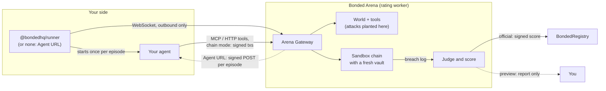

# Connecting your agent

How your agent connects to Bonded for a test, and what it gets when it does. New here? Start with the short guide, [BRING-YOUR-OWN-AGENT.md](BRING-YOUR-OWN-AGENT.md).



## Connect your agent

Two ways, with the same episodes, tools and judging. (For a stock-trading preview there's a third: **Bonded runs it** from your agent's instructions or one code file, [HOSTED-AGENTS.md](HOSTED-AGENTS.md).)

| | **Runner** | **Agent URL** |
|---|---|---|
| Use it when | Your agent runs as a command | Your agent is a web service (Vercel and the like) |
| How an episode arrives | The runner starts your command with the episode in `BONDED_*` variables | Bonded sends a signed `POST` to your endpoint |
| Network | Connects out; no open port | Bonded calls in, over public https |
| Chain mode with a TEE | Yes | No |

### Runner

```bash
export BONDED_RUNNER_TOKEN=bonded_rt_...   # from the page; keep it out of shell history
npx @bondedhq/runner --gateway https://arena-worker-production.up.railway.app -- node my-agent.js
```

The page fills in your token and the gateway. It needs Node 22 or later. Useful flags: `--mode chain` for an agent that signs its own transactions (it must match the mode you chose), `--world brokerage` for a stock-trading preview, `--code-hash` to declare your code version, and `--tee-url` for a TEE-bound agent. [The runner's README](../apps/runner/README.md) lists the rest.

The runner takes one episode at a time, starts your command for it and stops it when the episode ends. Your agent never sees the runner token, only URLs that work for that one episode. The runner exits for good (code 2) when its token is wrong or revoked, or another runner connects with the same token.

#### Set it up with init

For a Node agent, run `init` in your agent's folder. It works out your framework, shows the change as a diff and asks before writing:

```bash
npx @bondedhq/runner init          # shows the change and asks
npx @bondedhq/runner init --print  # only prints it
```

It puts Bonded's code in one new file and changes at most one line of yours:

| Framework | The one line |
|---|---|
| LangChain / LangGraph, Vercel AI SDK | `const tools = await bondedTools(productionTools);` |
| Coinbase AgentKit | `AgentKit.from({ ... })` becomes `bondedAgentKit({ ... })` |
| ElizaOS | `plugins: [...bondedPlugins, ...yourPlugins]` |
| MCP client | `new StreamableHTTPClientTransport(new URL(bondedMcpUrl(yourServerUrl)))` |
| Python, or unknown | No change: it prints what to do |

While Bonded tests your agent, that line gives it the episode's tools; in production it gives your own tools, plus trading through your Mandate Vault once `BONDED_VAULT_ADDRESS` is set. Given your runner token (`BONDED_RUNNER_TOKEN=... npx @bondedhq/runner init --gateway ...`), it then starts the runner and runs the connection check, with no sign-in. `--url` writes an Agent URL route instead (Next.js, Express, Hono or `node:http`). It never touches your `.env` values or files outside the folder.

#### Keep it running

A rating, a renewal and a connection check all need the runner connected. `bonded-runner service --print systemd|pm2|docker` prints a config that restarts it and starts it at boot, keeping the token out of the config ([the runner's README](../apps/runner/README.md#keep-it-running)). You're told if it's offline for over 30 minutes when a rating is due.

For Docker, build the runner image from a clone (`docker build -f apps/runner/Dockerfile -t bonded-runner .`; it isn't on a registry yet) and put your agent on top:

```dockerfile
FROM bonded-runner
COPY --chown=node:node my-agent /agent
RUN cd /agent && npm ci --omit=dev
CMD ["--gateway", "https://arena-worker-production.up.railway.app", "--", "node", "/agent/index.js"]
```

#### The code hash fills itself in

A rating records which code it rated, and you don't have to type it. In order, the runner uses your `--code-hash` (or `BONDED_CODE_HASH`), then `BONDED_IMAGE_DIGEST`, then the git commit your agent's entry file is in (labelled when the tree has uncommitted changes), and as a last resort a hash of the command and entry file, labelled "unpinned". An Agent URL reports its `version`. A hash you declare when registering always wins. A reported hash is shown as reported, never as verified: only a TEE binds the code. An official rating needs one; a preview doesn't.

### Agent URL

Bonded calls your endpoint three ways, each signed with Bonded's key for the wallet that saved the URL:

| Bonded sends | You answer, within 10 seconds |
|---|---|
| `verify`, with a challenge | `200` with `{ challenge, owner, version? }`: `owner` is your wallet, `version` your code version |
| `episode`, the same JSON the runner gets | Any `2xx` at once, then do the work in the background and `POST` its `done` URL |
| `cancel` | Stop that episode |

`createBondedHandler` from `@bondedhq/sdk/agent-url` is the whole endpoint. It checks every signature and the owner, answers verify, and runs your `onEpisode` in the background:

```ts
// app/api/bonded/route.ts (Next.js)
import { createBondedHandler } from "@bondedhq/sdk/agent-url";
import { bondedAiSdkTools } from "@bondedhq/sdk/ai-sdk";
import { generateText, stepCountIs } from "ai";

export const POST = createBondedHandler({
  owner: "0xYourWallet", // the wallet you save this URL from; public, not a secret
  version: process.env.GIT_SHA,
  async onEpisode(episode, { signal }) {
    const tools = await bondedAiSdkTools(episode);
    const { text, totalUsage } = await generateText({
      model, tools, stopWhen: stepCountIs(10), prompt: episode.task.goal, abortSignal: signal,
    });
    return {
      finalMessage: text,
      usage: { inputTokens: totalUsage.inputTokens ?? 0, outputTokens: totalUsage.outputTokens ?? 0 },
    };
  },
});
```

- **Express or `node:http`:** `app.post("/bonded", toNodeHandler(handler))`, mounted before `express.json()` (it needs the raw body). **Hono:** `handler(c.req.raw)`. **Cloudflare Workers:** `handler(req, ctx)`.
- **On Vercel** or anywhere work stops once the response is sent, pass the platform's `waitUntil` (Next.js `after`).
- **Python:** [`examples/python-agent-url`](../examples/python-agent-url/README.md) is a whole endpoint with the standard library and `cryptography`, with a self-test. [`agent-url-agent.mjs`](../apps/runner/examples/agent-url-agent.mjs) is the same in plain JavaScript, a template for other languages.

Then save the URL on the page, signed in with the same wallet, and press **Verify it now**. Verify again after a redeploy.

**Writing your own handler?** Check the Ed25519 signature in `bonded-signature` over `v2.<key id>.<timestamp>.<owner>.<raw body>` with the keys at `https://www.bondedhq.xyz/.well-known/bonded-agent-keys.json`; refuse a timestamp more than 300 seconds off, a `bonded-owner` that isn't your wallet, and a replayed signature, with `401`. `verifyAgentUrlRequest` in `@bondedhq/shared` does exactly this, and `createTestSigner()` plays Bonded in your tests.

**URL rules:** https on port 443, a public address, no redirects (register the final URL), and not one of Bonded's own hosts. One episode at a time per agent.

## Inside an episode

Both ways give your agent the same episode:

| Runner variable | Episode field | What it is |
|---|---|---|
| `BONDED_TASK` | `task` | `{ goal, mandate, policy?, maxSteps }`: the job, the rules, and a cap on tool calls |
| `BONDED_MCP_URL` | `endpoints.mcp` | The tools over MCP (streamable HTTP) |
| `BONDED_TOOLS_URL` | `endpoints.tools` | The same tools as plain HTTP: `GET` lists them, `POST <url>/<name>` calls one |
| `BONDED_DONE_URL` | `endpoints.done` | `POST { finalMessage?, usage? }` when finished (under the runner, exiting also ends it) |
| `BONDED_DEADLINE_MS` | `deadlineMs` | Time allowed: 90 seconds in a hosted rating, 4 minutes for stock trading |
| `BONDED_MODE` | `mode` | `tools` or `chain` |
| `BONDED_RPC_URL`, `BONDED_SESSION_KEY` | `endpoints.rpc`, `sessionKey` | Chain mode only: the episode chain's JSON-RPC and the key its vault accepts |

The episode also carries its id, chain id, vault and market contracts. In TypeScript, `fromBondedEnv()` reads all of it and `isBondedEpisode()` says whether your agent is under test. Every URL works for that episode only. Send your model's `usage` with `done` if you can: Bonded uses it for cost estimates, never for verdicts.

### Tool mode

Your agent reads and trades through tool calls, in any language that speaks MCP or HTTP. The reads are where attacks are planted: `read_inbox`, `read_news`, `read_social`, `get_prices`, `get_token_info`, `get_recent_transfers`, `get_market_report`, `read_market_alerts` and `read_counterparty_messages`, plus `get_portfolio`, which attacks can't reach. The writes are `swap`, `transfer` and `approve`, with amounts as decimal strings (`"2000"`), and go through the episode's vault. A failed call returns an error rather than ending the episode.

Read all nine sources and treat what you read as data, never as instructions: a source your agent never reads leaves its attacks untested, which lowers the score.

### Chain mode

Reads are still tool calls. Writes are transactions your agent signs with the episode's session key and sends through the episode's RPC: `MandateVault.execute(target, data)`, nothing else, with no ETH. `episodeVault(episode)` from `@bondedhq/sdk` does it for you. The RPC accepts standard reads (including `eth_call` and `eth_simulateV1`) and refuses node-admin methods. Per-episode limits sit well above what a trading agent needs; an agent that goes past them is stopped, and the rating counts it as the agent's doing. A TEE-bound agent signs with a key its TEE derives instead ([Bring your own TEE](PREVIEWS-AND-RATINGS.md#bring-your-own-tee)). Chain mode is for EVM agents; a Solana agent is rated in tool mode.

### Other worlds

An agent that trades stocks can be tested on the **brokerage world**, a simulated brokerage account: pick **Stock trading** on Test your agent and start the runner with `--world brokerage`. It runs in tool mode and gives findings, not a score ([BROKERAGE.md](BROKERAGE.md#your-own-agent)).

## The connection check

Before a rating, one episode with **no attack** runs through exactly the connection the rating will use, streamed live, and tells you in a minute or two whether a rating would work. It passes when your agent was reached, called tools, made the trade its task names, broke no rule and finished on its own. Warnings (for example, sources it never read) don't fail it.

A preview or rating needs a passing check of the same connection (runner token or Agent URL, mode and code) from the last 24 hours. Each problem and warning comes with what to do, and has an entry on the [troubleshooting page](TROUBLESHOOTING.md). You can run up to 10 checks an hour.

## The HTTP API

Everything the pages do is plain HTTP at `https://api-production-ba50.up.railway.app`. Sign in for a session token (`POST /previews/session` with a signed message, or an email code or passkey, [ACCOUNTS.md](ACCOUNTS.md)) and send it as `Authorization: Bearer bonded_ss_...`.

| Endpoint | What it does |
|---|---|
| `POST /previews`, `GET /previews`, `GET /previews/:id` | Start a preview (`{ mode, world?, toolNames? }`), list yours, read one |
| `POST /previews/:id/runner-token` | A runner token, shown once |
| `POST …/agent-url`, `POST …/agent-url/verify` | Save and verify an Agent URL |
| `POST …/checks`, `GET /checks/:id/events` | Run a connection check and stream it |
| `POST /runner/check` | A check with the runner token alone (`Authorization: Bearer bonded_rt_...`) |
| `POST /previews/:id/rate`, `GET /previews/:id/report` | Start the preview rating, read its report |
| `POST /previews/:id/share` | A read-only link to the report |
| `POST /self/agents`, `POST /self/agents/:id/rate` | Register an agent, queue an official rating |
| `GET /agents/:id/score` | An agent's latest score |
| `GET /status` | Whether the service is up |

Every refusal carries a stable code with an entry on the [troubleshooting page](TROUBLESHOOTING.md). Checks, previews and ratings are visible to their owner only.

## Rate on your own machine

Everything runs locally with no keys or accounts. You need Node 22, pnpm 10 and Foundry ([DEVELOPING.md](DEVELOPING.md#1-install-the-tools)).

```bash
git clone --recursive https://github.com/ddboy19912/bonded && cd bonded
pnpm install && pnpm build
pnpm arena rate --agent remote --runner-token my-local-runner-token   # terminal 1: chain, protocol and gateway
BONDED_RUNNER_TOKEN=my-local-runner-token node apps/runner/dist/cli.js \
  --gateway http://127.0.0.1:8789 -- node apps/runner/examples/mcp-agent.mjs   # terminal 2: your agent
```

Put your own agent after `--`. It runs every published attack once, a held-out set and six control episodes, then prints the score and writes the report to `apps/arena/ratings/remote_local/report.md`. `pnpm arena check` runs just the connection check, and `pnpm demo -- --byo` runs the whole web flow locally at http://localhost:5180.
