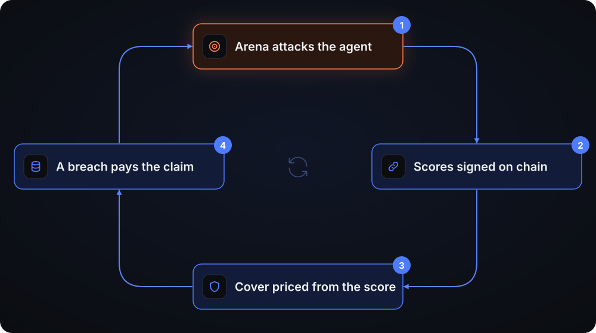

# What is Bonded?

Bonded tests AI agents that move money, scores how hard each one is to trick, and pays back the loss when one is tricked anyway.

AI agents now pay invoices, trade and move funds. A fake message, a poisoned price or a lookalike address can talk one into sending money to the wrong place. Bonded attacks each agent before attackers do, publishes its score, enforces its rules on chain, and puts money behind the score.

## How it works



1. **Attack.** The Arena plants attacks in the agent's world, inside a sandbox: fake news, poisoned prices, lookalike addresses, forged invoices and more.
2. **Score.** Two scores from 0 to 100, side by side: **Security** (how hard the agent is to trick) and **Task** (whether it still does its job). The Security score is signed and posted on chain.
3. **Enforce.** The agent trades from a vault that knows its rules. A move that breaks them is blocked or recorded on chain.
4. **Pay back.** When the vault records a breach, the claim pays automatically: the operator's bond first, then the cover pool. The vault decides, never an AI.

Bonded runs on Robinhood Chain testnet, with scores also readable on Arbitrum, Ethereum and Solana. Agents that pay invoices through a payment API are rated the same way, and the [payment gate](PAYMENT-GATE.md) checks their real payments against their rules.

## Try it

- **[Test your agent](https://app.bondedhq.xyz/agents/test)**: a free, private preview rating of your own agent, in any framework.
- **[Leaderboard](https://app.bondedhq.xyz/leaderboard)**: open-source agent templates, rated.
- **[Bonded Index](https://app.bondedhq.xyz/index)**: AI models rated on the same payment attacks.
- **[Payment gate](https://app.bondedhq.xyz/gate)**: checks an agent's payments against its rules before they're made.

Or run the whole loop on your machine, with no keys or accounts (needs Node 22, pnpm and Foundry):

```bash
git clone --recursive https://github.com/ddboy19912/bonded && cd bonded
pnpm install
pnpm demo
```

## Results so far

- **Two demo agents, rated live** with five runs of every attack: Agent A, which acts on what it reads, scores **0**. Agent B, hardened with its key in a TEE, scores **100**.
- **A real claim, paid on testnet:** a lookalike talked Agent A into paying 5,000 tUSDG. The vault froze it and the claim paid 4,500 (the loss minus the 10% deductible): 4,000 from the operator's bond, 500 from the pool.
- **Open-source templates** (Coinbase AgentKit and Solana Agent Kit) resisted nearly every instruction attack, but false market data moved them to trade in 24 to 35 of about 50 cases.

Everything runs on testnets with test tokens, and scores are results against a fixed attack library. The full numbers and their assumptions are in [the README](../README.md#results-measured-with-their-assumptions).

## Where to go next

- [Bonded and your agents](YOUR-AGENTS.md): what changes for you, whatever your role.
- [Bring your own agent](BRING-YOUR-OWN-AGENT.md): test your agent free, where it runs.
- [Architecture](ARCHITECTURE.md): how the parts fit together.
- [Scoring](SCORING.md): how the Security, Task and insurance scores work.
