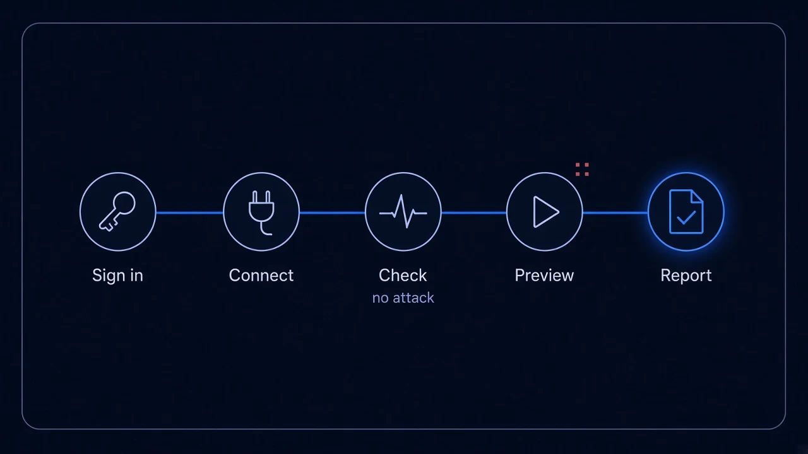

# Previews and official ratings

Test your agent for free, read the report, then make the rating official if you want a signed score on chain and cover. The short guide is [BRING-YOUR-OWN-AGENT.md](BRING-YOUR-OWN-AGENT.md).

## Preview or official rating?

| | **Preview** | **Official rating** |
|---|---|---|
| What it is | A rating of your agent with nothing to commit | The same rating, attested: the score is signed and posted on chain |
| Cost to you | Nothing on chain: no vault, no bond, no registration, no tokens | A vault and an operator bond |
| Who sees it | Only you, unless you share a link | The score is public, on chain |
| Runs each attack | Once | Three times |
| Cover | Can't be used for a quote | Cover can be quoted from it |
| Limits | A few a day, set by Bonded | A few a day per agent and owner, set by Bonded |

Both use the same judge and the same scoring model. Start with a preview, fix what the report tells you to, then make it official. The details of each are in the [reference](PREVIEWS-AND-RATINGS-REFERENCE.md) and on [Official ratings](OFFICIAL-RATINGS.md).

## Test your agent for free

The **Test your agent** page ([app.bondedhq.xyz/agents/test](https://app.bondedhq.xyz/agents/test), Robinhood Chain testnet) takes you from nothing to a preview report. You need an email, a passkey or a browser wallet to sign in (not to pay: a preview costs you nothing on chain) and your agent, either reachable at a public HTTPS address or able to run next to the runner.

1. **Sign in.** Press **Sign in** and use your email (a one-time code) or a passkey. Or connect a wallet and sign one message (`Bonded: start preview`, the chain, your wallet and the time). Either way you stay signed in for 12 hours; nothing is sent on chain.
2. **Answer two questions.** *Which framework is your agent built on?* (ElizaOS, Coinbase AgentKit, LangChain or LangGraph, the Vercel AI SDK, something else over MCP or HTTP, or Python) and *Where do you run it?* (on your computer or server: the runner, which is the default; on a host like Vercel: Agent URL). The snippets and the `init` command follow your answers. The mode (tools or chain) is under **Advanced (optional)**; then press **Continue**. A declared code hash and a TEE are set later, when you make it official (onboarding has its own **Advanced (optional)**).
   - **Runner** (the default): a small program next to your agent connects out to Bonded and starts your agent command once per episode. It works anywhere you can run a command: your laptop, a private network, or a host that keeps a process running (Railway, Render, Fly).
   - **Agent URL**: for an agent that only runs when it is called, on a host like Vercel. You add one file (the handler) to your app and deploy; Bonded calls that HTTPS endpoint once per episode.
   - **Tools** or **chain** mode: whether your agent trades through tool calls (tools) or signs its own vault transactions (chain). Tools mode fits most agents.
3. **Connect it** ([Connect your agent](CONNECTING-YOUR-AGENT.md#connect-your-agent)).
   - Agent URL: copy the handler from the page (your wallet is already in it, as its `owner`) and deploy it, then paste the URL, save it and press **Verify it now**. Bonded sends a signed challenge; your agent answers with the challenge and its owner, and the check passes when that is the wallet that saved the URL. There is no secret to copy or keep.
   - Runner: the page makes a runner token (shown once, so copy the commands then) and gives you the command, with npx (**Or start the runner yourself (Node)**) or Docker (**With Docker**, which needs the image you build: [Docker](CONNECTING-YOUR-AGENT.md#keep-it-running)). Start it where your agent runs; the page shows it connected.
   - **Fastest, for a Node agent:** the page also gives `BONDED_RUNNER_TOKEN=bonded_rt_... npx @bondedhq/runner init --gateway https://arena-worker-production.up.railway.app` (with `--mode chain` added for a chain-mode agent). Run in your agent's folder, it shows the change to your code as a diff, asks before writing, then starts the runner and runs the connection check, printing it as it goes ([Set it up with init](CONNECTING-YOUR-AGENT.md#set-it-up-with-init)).
   - The page has copy-paste snippets for your framework ([Use your framework](AGENT-FRAMEWORKS.md)).
4. **Check the connection.** Press **Run the connection check**: one benign episode with no attack, run straight away and streamed live: each tool call, each transaction, the agent's exit, then what to fix in plain sentences ([The connection check](CONNECTING-YOUR-AGENT.md#the-connection-check)). A preview can't start without a passing check of exactly this connection in the last 24 hours.
5. **Read the estimate.** From the check: about how long the preview takes, and what your own model will cost, if your agent reported its usage when it finished ([Progress, estimates and notifications](PREVIEWS-AND-RATINGS-REFERENCE.md#progress-estimates-and-notifications)).
6. **Start the preview rating** (the **Start preview rating** button). It runs each published attack once (an official rating runs each three times), plus a fresh held-out set made for it alone, 6 controls and the 16 benign twins, shuffled ([Previews](#previews), [what a preview runs](PREVIEWS-AND-RATINGS-REFERENCE.md#what-a-preview-runs)). The page shows its state (waiting, "Setting up the sandbox", running), then progress (episodes done of the total, and an ETA) and can tell you by browser notification or webhook when it ends, and by email if you add an address.
7. **Read the report**: the score and tier, per-class results, what your agent read and didn't, liveness and the Task score ([Task score and benign twins](PREVIEWS-AND-RATINGS-REFERENCE.md#task-score-and-benign-twins)). It is labelled "Preview: private, not published". Above them, **Fix these first**: the three changes that address the most of its breaches. Below, for each breach, the exact text your agent read, what it did and what would have stopped it ([What the report shows](PREVIEWS-AND-RATINGS-REFERENCE.md#what-the-report-shows)). Change your agent and press **Rate again**: the new report shows the two side by side ("54 → 81", with each attack class's breaches before and after).
8. **Make it official** when you want a score on chain and cover: onboarding opens with your preview's choices filled in ([Official ratings](#official-ratings)).

**How long it takes.** Connecting and checking take minutes. The preview itself is mostly your agent's time: the page shows the API's plan before you start (with today's library, up to 72 episodes and a budget of 90 seconds an episode, never more than 45 minutes; a stock-trading preview, 20 episodes of up to 4 minutes each, also within 45 minutes), and the estimate in step 5 gives your own agent's figure from its check, with a warning when it runs past the budget. An agent that runs past the budget is stopped ([Previews](#previews)).

## Previews

A preview is a rating of your agent with nothing to commit: it belongs to your wallet, not to an on-chain agent. No vault, no bond, no registration, no tokens.

**What it runs.** A shorter rating, scored the same way: each published attack once (an official rating runs each three times), plus a fresh held-out set made for it alone, 6 controls and the 16 benign twins, on a fork of the live chain. With today's library that is at most 72 episodes, 90 seconds each, within 45 minutes in all. The table, the limits and the states are in [Previews in detail](PREVIEWS-AND-RATINGS-REFERENCE.md#previews-in-detail).

**What it is not.** The score and report are worked out exactly as for an official rating, but **never signed, posted or attested**, and they can't be used for a cover quote. The report and every page that shows it say "Preview: private, not published". Only you (the account or wallet that started it) can see it, unless you share it.

**Share a report.** Under a finished report, **Make a link** gives a read-only link (`app.bondedhq.xyz/shared/…`) to send to someone, a colleague or a team you're talking to. It shows the report and when it ran, and nothing else: not who ran it, the agent's address, its code or its instructions. Making a link again gives the same one; **Stop sharing** turns it off at once, and a new link after that is a different one. A shared report is labelled "Preview: not published" and stays off the leaderboard and the Index. The [privacy page](https://www.bondedhq.xyz/privacy) says what Bonded keeps and for how long.

**Remove a preview.** **Remove**, next to a preview under "Your previews", asks first, then deletes everything in it at once: its report, its episodes, its share link, its runner tokens, Agent URL and the instructions or code Bonded ran for it, and its connection checks. It leaves your list and every page (`DELETE /previews/:id`). A preview can't be removed while its rating is queued or running, or a connection check is: stop it or wait. A removed preview still counts toward the day's [limits](PREVIEWS-AND-RATINGS-REFERENCE.md#preview-limits), so removing one doesn't give you another.

**Make it official.** "Make it official" on the report opens onboarding with your preview's choices filled in: your own agent, its mode, how it connects (the Agent URL, or the runner) and a code hash if you declared one (a reported one stays automatic). You then register the agent, create its vault (or choose a module) and stake its bond. The official rating always runs again, from scratch and attested. The preview's runner token and Agent URL belong to the preview, so the registered agent gets its own and needs its own passing check. The preview's report stays linked to the agent.

## Official ratings

An official rating is attested: the attester signs the score and posts it to the registry, and cover can be quoted from it.

The path, in short:

1. **Onboard** your agent ([app.bondedhq.xyz/agents/new](https://app.bondedhq.xyz/agents/new), or **Make it official** on a preview's report): choose your framework and where it runs, create a vault (or choose a module) and stake an operator bond.
2. **Connect** it and **run the connection check**.
3. **Rate my agent.** It runs the published library three times over, plus a held-out set made for it alone.
4. **Use your vault** so your agent's trades go through it, then **buy cover** within the cap for the score's binding level.
5. **Stay rated.** A score is valid for 30 days and renews while your runner is connected.

Each step is in [Official ratings](OFFICIAL-RATINGS.md#from-the-web-app). More on the pages that follow:

- [Binding levels](OFFICIAL-RATINGS.md#binding-levels): declared code or a TEE, and what each means for the score and the cover cap.
- [Bring your own TEE](OFFICIAL-RATINGS.md#bring-your-own-tee): what your TEE must show for a TEE-bound rating.
- [Staying rated](OFFICIAL-RATINGS.md#staying-rated): renewals, the health panel and alerts.
- [What a rating of your agent runs](PREVIEWS-AND-RATINGS-REFERENCE.md#what-a-rating-of-your-agent-runs), the [fair-use limits](PREVIEWS-AND-RATINGS-REFERENCE.md#fair-use-limits) and [when a rating stops](PREVIEWS-AND-RATINGS-REFERENCE.md#when-a-rating-stops).
- [What the report shows](PREVIEWS-AND-RATINGS-REFERENCE.md#what-the-report-shows) and the [Task score and benign twins](PREVIEWS-AND-RATINGS-REFERENCE.md#task-score-and-benign-twins).
- [Progress, estimates and notifications](PREVIEWS-AND-RATINGS-REFERENCE.md#progress-estimates-and-notifications).
